# Bayu node

Bayu is the Making Sense Bali air quality node. The one deployed today is Bayu v3: a Seeed
XIAO ESP32-S3 with a BME680 and an HM3301, built on a Grove Shield or Fab Lab Bali's own PCB
and housed in the [node-v3.2](../diy-node/enclosure/node-v3.2/) enclosure.

The four new variants keep the XIAO and add the sensors we have now: a Sensirion SEN54 and
Plantower PMS5003 or PMS5003T for particulate matter, an SHT40 for temperature and
humidity, and an SCD40 for CO₂ indoors. Every node has WiFi. Where WiFi doesn't reach,
nodes talk to each other over LoRa with Meshtastic, through the Wio-SX1262 board that clips
on top of the XIAO. It is one board, fitted differently depending on what you want to
measure and where. Every kit stays under USD 100.

Why the design is the way it is, the costs, where to buy parts in Indonesia and elsewhere,
and the firmware plan are in [DESIGN.md](DESIGN.md). This page is the map of the drawings.

| | |
|---|---|
| Stage | Bayu v3 is deployed. The four new variants are at concept stage: drawn and checked against datasheets, the Seeed schematic and the firmware, not yet built. Breadboard builds come next. |
| For | Fab labs and workshop facilitators building nodes, and anyone replicating the campaign in another city. |
| Contact | [Open an issue](https://github.com/Meaningful-Design-Group/makingsensebali/issues) on the repository. |
| Home | https://github.com/Meaningful-Design-Group/makingsensebali/tree/main/hardware/bayu-node |
| Licences | CERN-OHL-W-2.0 hardware, CC-BY-SA-4.0 docs, MIT scripts. See [Licences](#licences). |

If you build one, tell us what is wrong.

## Bayu v3 and the four new variants

| | Sensors | Where it goes | Kit, USD | Firmware |
|---|---|---|---|---|
| [**Bayu v3**](../diy-node/) | BME680, HM3301, LoRa optional | Deployed today, indoors and out. Temperature, humidity, VOC and PM. | not priced yet | Bayu firmware v5 |
| [**Anchor**](circuits/anchor/) | SEN54, PMS5003, SHT40, LoRa | One per cluster, outdoors. The local reference the cheap nodes are corrected against. | about 91 | Meshtastic, Bayu image |
| [**Dense**](circuits/dense/) | PMS5003T, LoRa optional | Many, on kos rooms, warungs and family compounds, put up by workshop participants. | about 52, 58 with LoRa | Meshtastic `_t` image, or Bayu firmware v5 |
| [**Indoor**](circuits/indoor/) | PMS5003, SCD40, SHT40 | Classrooms, kos rooms, kitchens with a mosquito coil going. | about 70 | Bayu firmware v5 or Meshtastic |
| [**Relay**](circuits/relay/) | SHT40, LoRa | Only where a cluster has no node with WiFi. Carries the mesh to the internet. | about 36 to 40 | Meshtastic, Bayu image |

A fifth variant, Mobile, with GPS and a battery for transects on a motorbike, is in the
design and comes later.

### Bayu v3, the node in the field

Grove BME680 and Grove HM3301 on the two I2C sockets of the Grove Shield. It is the only
configuration that is fully plug and play on today's shield, and the Wio-SX1262 stacks on
it for LoRa. The build guide, wiring for the shield and for Fab Lab Bali's PCB, and the
enclosure are in [`../diy-node/`](../diy-node/).

<table>
<tr>
<td width="50%"><a href="../diy-node/enclosure/node-v3.2/img/10-breadboard-grove-shield.png">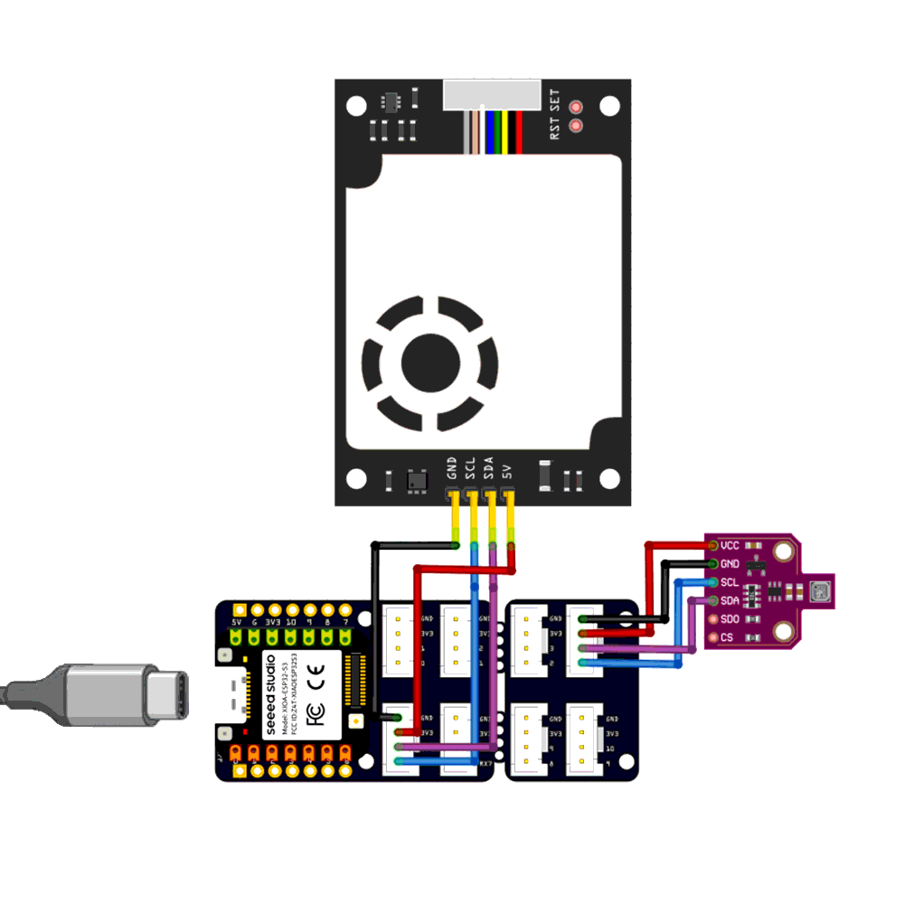</a></td>
<td width="50%"><a href="../diy-node/enclosure/node-v3.2/img/02-internal-layout.png">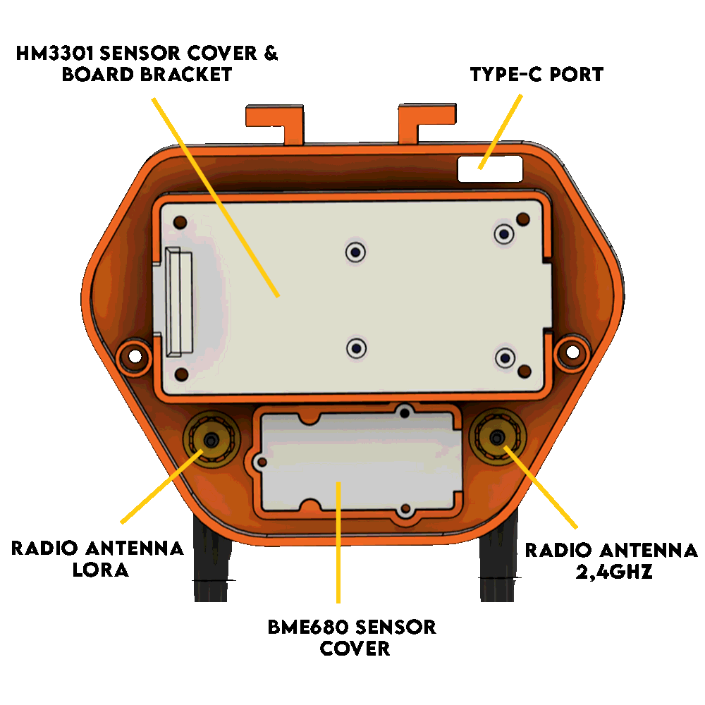</a></td>
</tr>
<tr><td>Wiring on the Grove Shield</td><td>Inside the node-v3.2 enclosure</td></tr>
</table>

[Build it yourself](../diy-node/BUILD-IT-YOURSELF.md) · [Set up an assembled one](../diy-node/SETUP-ASSEMBLED.md) · [Enclosure](../diy-node/enclosure/node-v3.2/)

### Anchor

SEN54 and PMS5003 side by side, breathing the same air, so every PMS5003 in the cluster
can be corrected against it. Its first week is next to a Smart Citizen Kit.

<table>
<tr>
<td width="50%"><a href="circuits/anchor/wiring-breadboard.svg">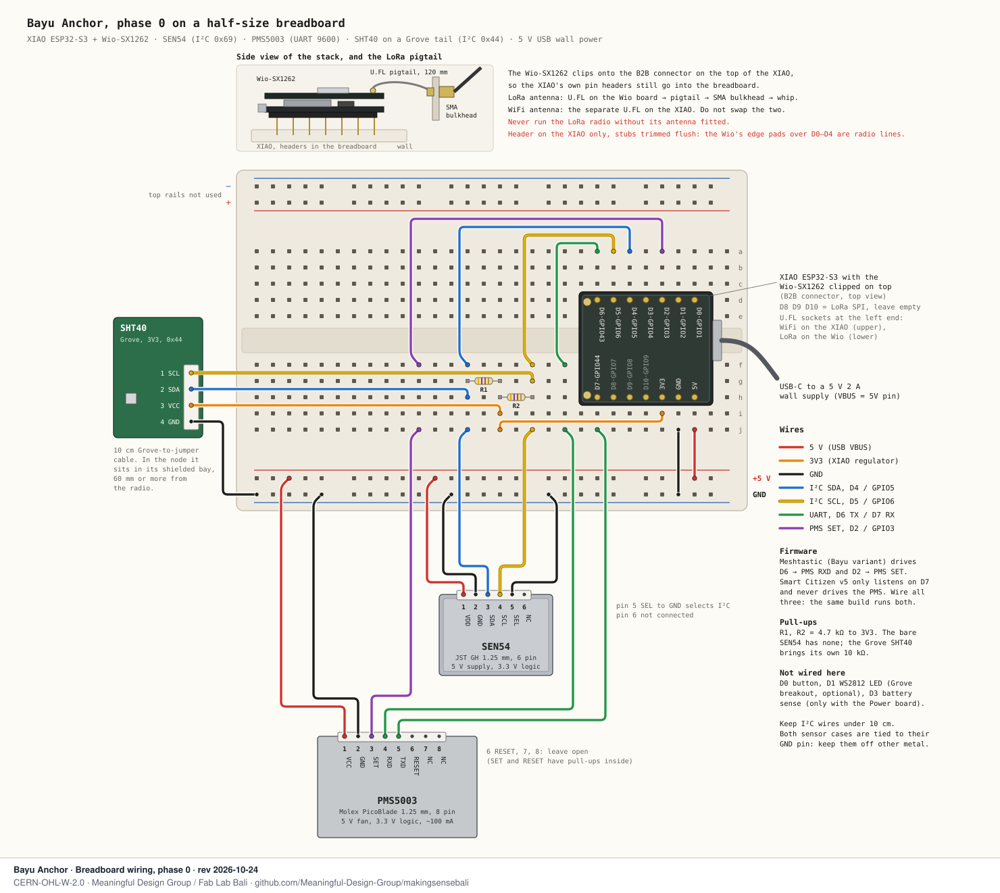</a></td>
<td width="50%"><a href="circuits/anchor/placement.svg">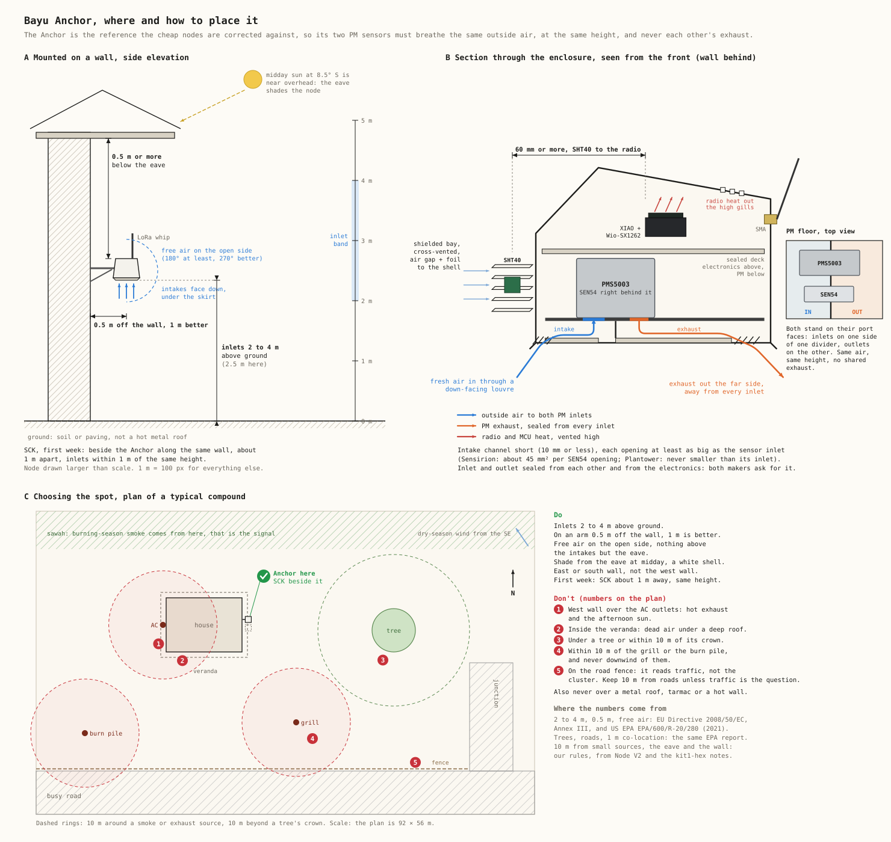</a></td>
</tr>
<tr><td>Breadboard wiring</td><td>Placement</td></tr>
</table>

[Schematic](circuits/anchor/schematic.svg) · [Core connector map](circuits/anchor/wiring-core.svg) · [Pins, parts and placement rules](circuits/anchor/)

### Dense

The cheap one, with five wires between the PMS5003T and the XIAO. The placement sheet
uses pictograms so a resident can follow it without reading English.

<table>
<tr>
<td width="50%"><a href="circuits/dense/wiring-breadboard.svg">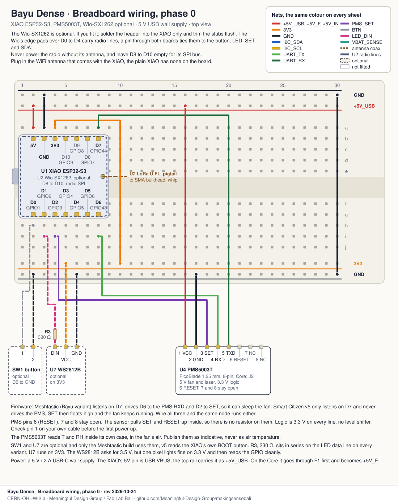</a></td>
<td width="50%"><a href="circuits/dense/placement.svg">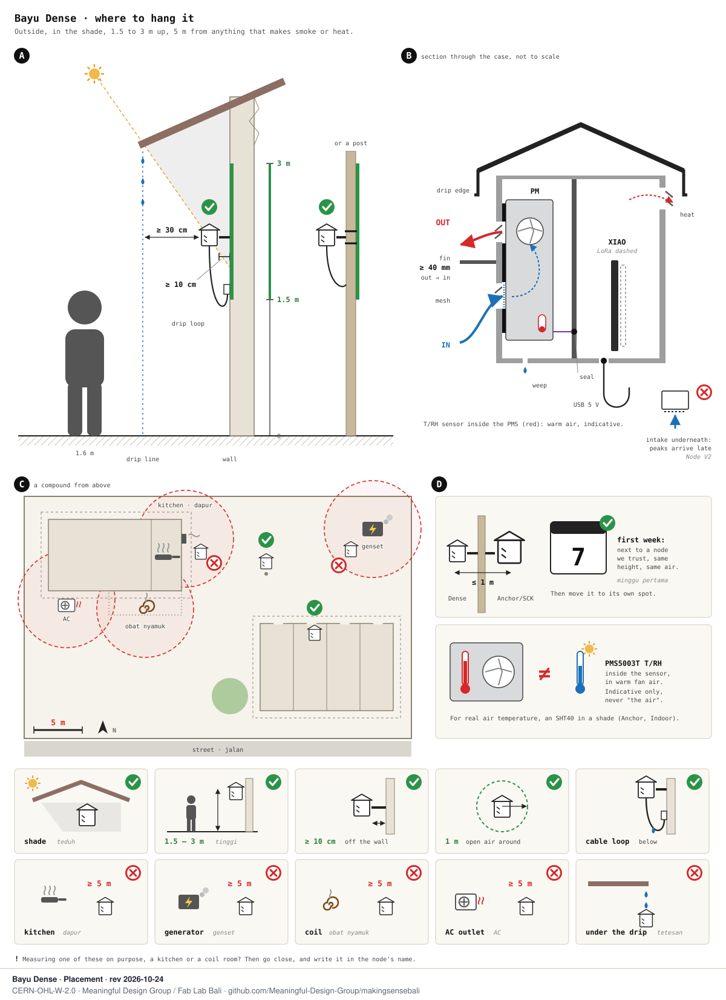</a></td>
</tr>
<tr><td>Breadboard wiring</td><td>Placement</td></tr>
</table>

[Schematic](circuits/dense/schematic.svg) · [Core connector map](circuits/dense/wiring-core.svg) · [Pins, parts and placement rules](circuits/dense/)

### Indoor

PM, CO₂ and climate for a room. Placement matters as much as wiring here: breathing
height, a metre from people, away from the AC and the stove, and fresh air once a week so
the SCD40 can calibrate itself.

<table>
<tr>
<td width="50%"><a href="circuits/indoor/wiring-breadboard.svg">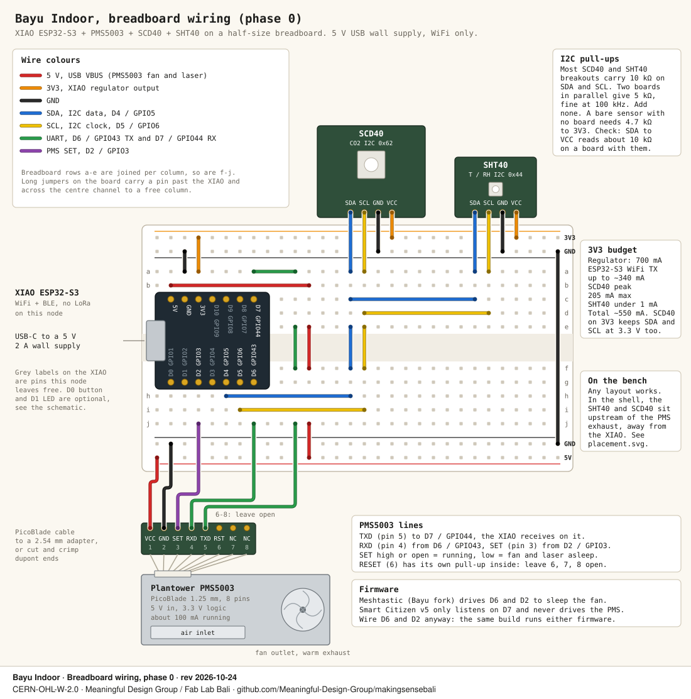</a></td>
<td width="50%"><a href="circuits/indoor/placement.svg">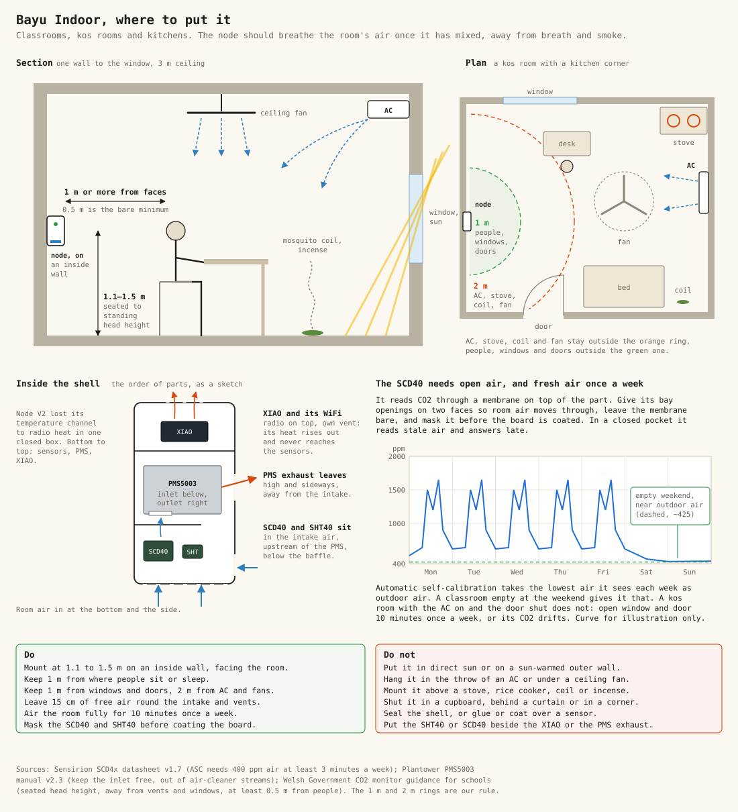</a></td>
</tr>
<tr><td>Breadboard wiring</td><td>Placement</td></tr>
</table>

[Schematic](circuits/indoor/schematic.svg) · [Core connector map](circuits/indoor/wiring-core.svg) · [Pins, parts and placement rules](circuits/indoor/)

### Relay

The Relay has no PM sensor. The whip goes above the roof ridge and the SHT40 goes low in
the shade. Its README also has the Meshtastic settings every node in a cluster needs.

<table>
<tr>
<td width="50%"><a href="circuits/relay/wiring-breadboard.svg">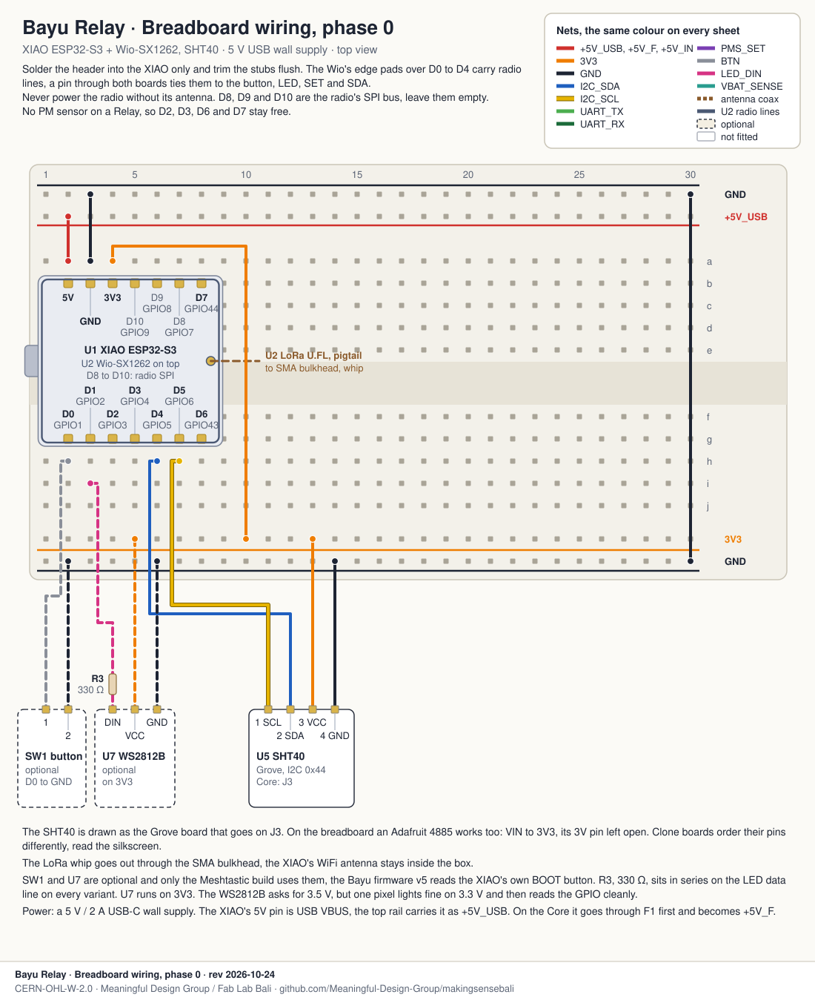</a></td>
<td width="50%"><a href="circuits/relay/placement.svg">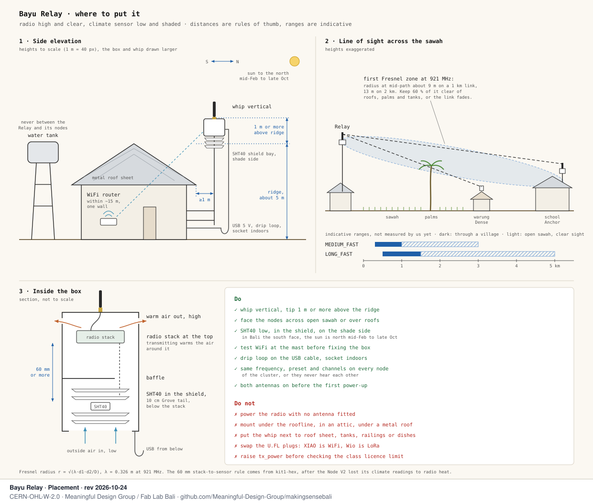</a></td>
</tr>
<tr><td>Breadboard wiring</td><td>Placement</td></tr>
</table>

[Schematic](circuits/relay/schematic.svg) · [Core connector map](circuits/relay/wiring-core.svg) · [Pins and Meshtastic settings](circuits/relay/)

## Pins, the same on every variant

A variant only leaves pins empty. No pin changes job between variants, so one Core board
and one firmware image serve all four.

| XIAO | GPIO | Job | v3 | Anchor | Dense | Indoor | Relay |
|---|---|---|---|---|---|---|---|
| 5V | VBUS | 5 V for the PM sensors' fans | | ● | ● | ● | |
| 3V3 | | 3.3 V for the I²C sensors and the LED | ● | ● | ● | ● | ● |
| D4 | 5 | I²C SDA | ● | ● | | ● | ● |
| D5 | 6 | I²C SCL | ● | ● | | ● | ● |
| D6 | 43 | UART TX to the PMS RXD | | ● | ● | ● | |
| D7 | 44 | UART RX from the PMS TXD | | ● | ● | ● | |
| D2 | 3 | PMS SET, fan sleep | | ● | ● | ● | |
| D0 | 1 | button | | ○ | ○ | ○ | ○ |
| D1 | 2 | WS2812 status LED | | ○ | ○ | ○ | ○ |
| D3 | 4 | battery sense, Power board only | | ○ | | | |
| D8 to D10 | 7, 8, 9 | LoRa SPI, taken by the Wio-SX1262 | ○ | ● | ○ | | ● |

● wired · ○ optional

The Bayu firmware v5 only listens to the PMS on D7. The Meshtastic Bayu image also
uses D6 and D2 to sleep the fan between readings. Wire all three and the same node runs
either.

## Plug and play with Grove

Every variant can be built on the Seeed Grove Shield for XIAO with Grove cables. Bayu v3
and the Relay are fully plug and play on it today. The Plantower nodes need one extra wire,
because the shield's sockets give 3V3 and the PMS5003 fan needs 5 V. An Anchor with a bare
SEN54 needs a second one.
[Bayu on the Grove Shield](grove/) has the socket map for each variant.

To compare PM sensors, Bayu v3 can also carry a bare SEN54 and a PMS5003 next to its
HM3301 on the same shield: [Bayu v3 with three PM sensors](grove/v3-three-pm/).

We are also proposing a smaller board to Seeed, with four sockets, a clock and a microSD
slot, on which every variant plugs in:
[Grove Shield Mini for XIAO](grove-shield-mini/).

<a href="grove/grove-shield-map.svg">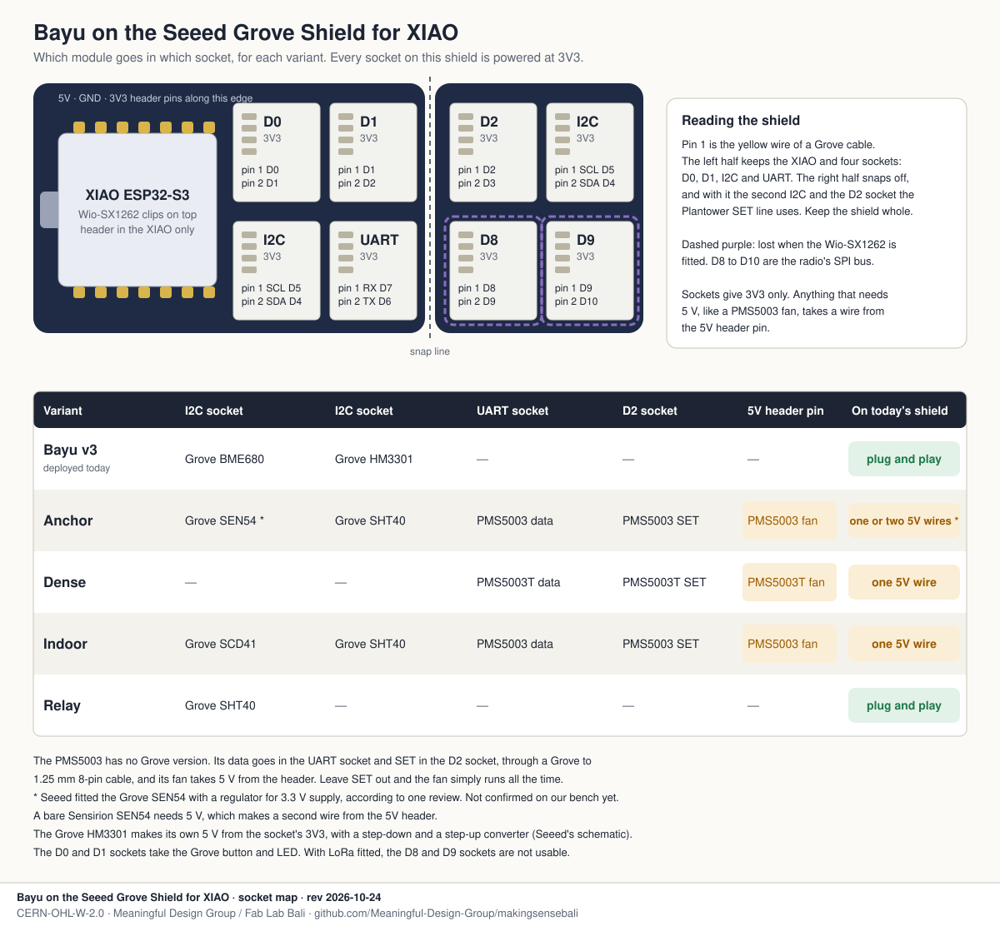</a>

## Before you solder

- Solder the header into the XIAO only. The Wio-SX1262 clips on top of the XIAO, and its
  edge pads sit right over D0 to D4 carrying radio lines. Trim the stubs flush before the
  Wio goes on, because one pin through both boards ties the button, the LED, SET and SDA
  to the radio.
- Buy the XIAO and the Wio as Seeed's kit. The board-to-board radio is only sold that way,
  and a plain XIAO may come without the connector fitted.
- Put the antennas on before you power it. The SX1262 can be damaged transmitting into an
  open connector.

## Firmware

- Meshtastic with the Bayu sensors: branch `bayu` of
  [Meaningful-Design-Group/firmware](https://github.com/Meaningful-Design-Group/firmware/tree/bayu),
  build envs `seeed_xiao_s3_bayu` and `seeed_xiao_s3_bayu_t` for the PMS5003T. How to build,
  flash and set the region is in `BAYU.md` on that branch.
- The Bayu firmware v5, which the Bayu v3 nodes run and which also reads the PMS5003, PMS5003T, SHT4x and SCD4x:
  [`../diy-node/firmware/diy_node_v5/`](../diy-node/firmware/diy_node_v5/).

## Folders

```
bayu-node/
├── README.md       this page
├── DESIGN.md       the design: roles, boards, costs, sourcing, mesh, firmware
├── bom.csv         every part, every variant, Open-Make columns
├── CHANGELOG.md    what changed and why, including what we got wrong
├── LICENSES/       CERN-OHL-W-2.0, CC-BY-SA-4.0, MIT
├── grove/          Bayu on the Seeed Grove Shield, socket map per variant, the three-PM build
├── grove-shield-mini/  the board we are proposing to Seeed, and its generator
└── circuits/
    ├── anchor/     ┐
    ├── dense/      │ each: wiring-breadboard.svg, wiring-core.svg,
    ├── indoor/     │ schematic.svg, placement.svg, README.md
    └── relay/      ┘
```

## Licences

| What | Licence | SPDX |
|---|---|---|
| Drawings, board concepts and the bill of materials: `circuits/`, the SVGs in `grove/` and `grove-shield-mini/`, `bom.csv` | CERN Open Hardware Licence v2, weakly reciprocal | `CERN-OHL-W-2.0` |
| Documentation: every `.md` file | Creative Commons Attribution-ShareAlike 4.0 | `CC-BY-SA-4.0` |
| Scripts that generate drawings: every `.py` file, `circuits/draw_circuits.py` and the ones next to the drawings in `grove/` and `grove-shield-mini/` | MIT | `MIT` |

The full texts are in [`LICENSES/`](LICENSES/). Copyright 2026 Meaningful Design Group /
Fab Lab Bali.
