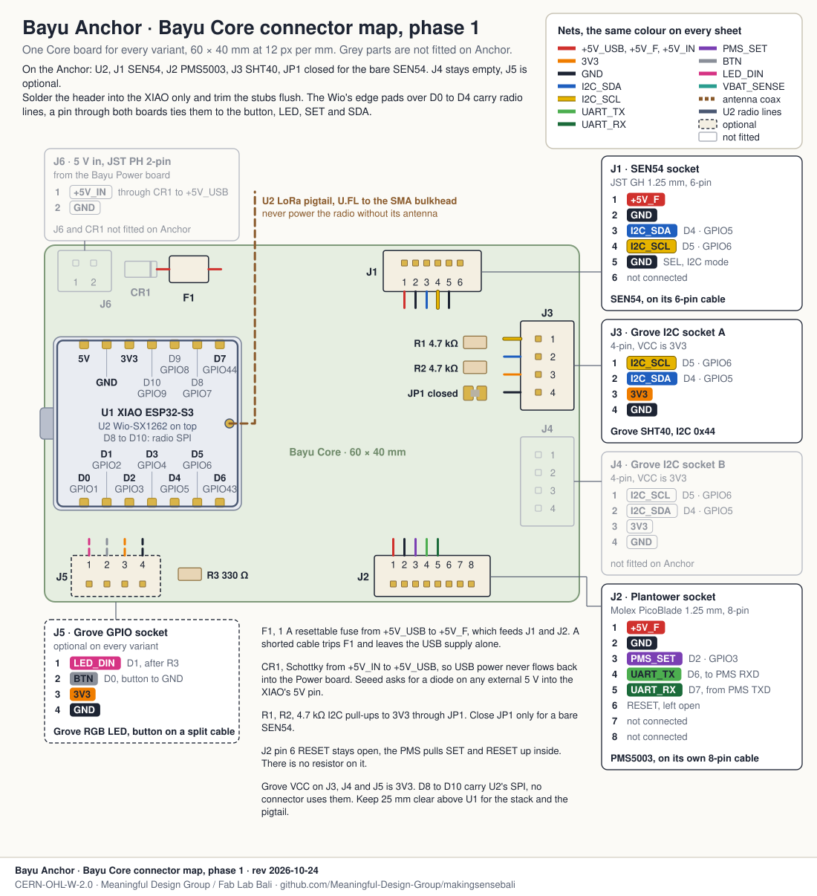
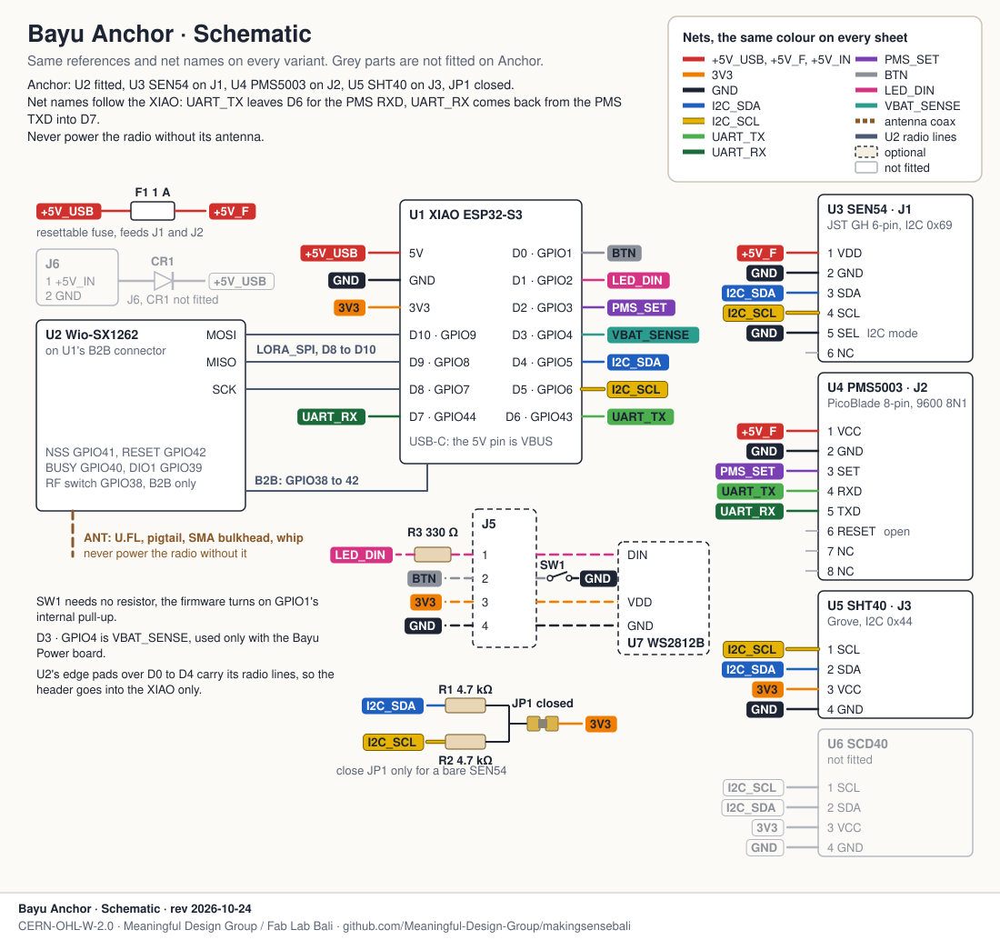

# Bayu Anchor, wiring and placement

The Anchor is the Bayu node that carries both PM sensors, a Sensirion SEN54 and a Plantower PMS5003, plus an SHT40 for temperature and humidity and the Wio-SX1262 for LoRa. It is the local reference. Every cheap PMS5003 node in a cluster gets its correction from the nearest Anchor, and each Anchor spends its first week next to a Smart Citizen Kit. The design and the reasoning behind it are in [`../../DESIGN.md`](../../DESIGN.md); this folder is only how to wire one and where to hang it.

Outdoor, 5 V USB wall power, Meshtastic firmware (Bayu variant). Phase 0 is a breadboard, phase 1 the Bayu Core carrier board.

## Wiring

### Phase 0, on a breadboard

The XIAO goes at the left end of a half-size breadboard, across the centre channel, with its USB-C off the edge. The Wio-SX1262 rides on top of it, so the XIAO's own headers still go into the board. The top rails carry `+5V_USB` and GND, the bottom rails 3V3 and GND. The sensors sit below the board and take their power from the rail straight above each pin. R1 and R2, the two 4.7 kΩ pull-ups, go from the SDA and SCL columns to the 3V3 rail.

### Phase 1, on the Bayu Core

The Core is planned and not routed yet. It is one board for every variant, laid out in [`../CONVENTIONS.md`](../CONVENTIONS.md), so this map is the same on all four. Pin numbers and nets are fixed, they come from the sensor datasheets and the firmware.

### Schematic

### Pin table

| Signal | XIAO pin | GPIO | Goes to | Breadboard | Core |
|---|---|---|---|---|---|
| 5 V | 5V | USB VBUS | SEN54 pin 1, PMS5003 pin 1 | top `+5V_USB` rail | J1.1, J2.1, after F1 |
| 3V3 | 3V3 | regulator out | SHT40 VCC, R1, R2 | bottom 3V3 rail | J3.3, J4.3, J5.3 |
| GND | GND | | SEN54 pins 2 and 5, PMS5003 pin 2, SHT40 GND | both GND rails | every connector |
| I²C SDA | D4 | 5 | SEN54 pin 3, SHT40 SDA | column 6, rows h to j | J1.3, J3.2, J4.2 |
| I²C SCL | D5 | 6 | SEN54 pin 4, SHT40 SCL | column 7, rows h to j | J1.4, J3.1, J4.1 |
| UART TX | D6 | 43 | PMS5003 pin 4 RXD | column 8, row i | J2.4 |
| UART RX | D7 | 44 | PMS5003 pin 5 TXD | column 8, row a | J2.5 |
| PMS SET | D2 | 3 | PMS5003 pin 3 | column 4, row i | J2.3 |
| Button | D0 | 1 | optional button to GND, on a split cable | column 2, row h | J5.2 |
| Status LED | D1 | 2 | optional Grove RGB LED (WS2812), through R3 (330 Ω) | column 3, row i | J5.1 |
| Battery sense | D3 | 4 | only with the Bayu Power board | | |
| LoRa SPI | D8, D9, D10 | 7, 8, 9 | Wio-SX1262, through the B2B connector | leave empty | none |
| LoRa control | | 38 to 42 | Wio-SX1262, through the B2B connector | | |

PMS5003 pin 6 (RESET) and pins 7 and 8 stay open. SEN54 pin 6 is not connected.

On firmware, the Meshtastic Bayu variant ([`variant.h`](https://github.com/Meaningful-Design-Group/firmware/blob/bayu/variants/esp32s3/seeed_xiao_s3_bayu/variant.h), branch `bayu`) drives D6 to the PMS RXD and D2 to SET, so it can sleep the fan between reads. The Smart Citizen firmware v5 in [`../../../diy-node/firmware/diy_node_v5/`](../../../diy-node/firmware/diy_node_v5/) only listens on D7 and never drives the PMS. Wire all three lines and the same node runs either.

### Bill of materials

Prices are single units from [`DESIGN.md`](../../DESIGN.md#cost-per-kit), October 2026.

| Qty | Part | Notes | USD |
|---|---|---|---|
| 1 | Seeed XIAO ESP32-S3 + Wio-SX1262 kit | Buy the kit. The radio that clips onto the XIAO's B2B connector is the kit version, see the checks below. | 9.90 as a kit, 13.50 apart |
| 1 | Sensirion SEN54-SDN-T + 6-pin cable | JST GHR-06V-S compatible plug. No local stock in Indonesia. | 32 |
| 1 | Plantower PMS5003 with its 8-pin cable | Molex PicoBlade 1.25 mm. | 15 |
| 1 | SHT40 breakout, Grove or Adafruit class | Must have its own regulator and pull-ups. | 4 |
| 1 | Grove-to-jumper cable, 10 cm | for the SHT40 | |
| 2 | 4.7 kΩ resistor | R1, R2, I²C pull-ups to 3V3 | |
| 1 | Half-size breadboard and jumper wires | phase 0 only | |
| 1 | U.FL to SMA bulkhead pigtail, 120 mm, and a 915 MHz band whip | the band covers 920 to 923 MHz | |
| 1 | 5 V 2 A USB-C supply and cable | | 5 |
| 1 | Bayu Core board with connectors | phase 1, replaces the breadboard | 8 |
| 1 | Printed enclosure, PETG or ASA | | 8 |
| | Insect mesh, coating, ties, SMA bulkhead | | 5 |
| | **Total, phase 1** | | **about 91** |

## Placement

**Height and wall:** inlets between 2 and 4 m above ground, which fits both the EU directive (1.5 to 4 m) and the US EPA (2 to 15 m). Mount it on an arm with open air on the free side. The EU asks for 0.5 m from the building and the EPA for more than 1 m from any supporting structure, so 0.5 m is the least and 1 m is better.

**Sun and roof:** at 8.5° S the midday sun is close to overhead, so the eave shades the node better than the choice of wall does. Keep it 0.5 m or more under the eave, out of the corner where wall and roof meet. Avoid the west wall, and never mount it over a metal roof, tarmac or a hot wall.

**Sources:** keep it 10 m from a grill, kitchen, burn pile, generator or AC outlet, and never downwind of one. Keep it more than 10 m from a tree's crown and from roads. A node on a road fence reads the traffic, which is a different question from the cluster.

**Inside the enclosure:** the SEN54 and the PMS5003 stand on their port faces, side by side, inlets on one side of a single divider and outlets on the other. They draw from one shared intake plenum through a short, down-facing louvre, and blow out the opposite face. Neither sensor ever breathes the other's exhaust, and both sample the same air at the same height, which is what the cheap nodes get corrected against.

**SHT40:** in its own shielded, cross-vented bay outside the shell, 60 mm or more from the radio, on the intake side, never downstream of the PM exhaust.

**First week:** next to a Smart Citizen Kit, about 1 m apart, inlets within 1 m of the same height (the EPA asks for the same).

Node V2 also took its air from below, and its PM peaks lagged, because the air came through a narrow grille under a long, closed belly. Sensirion asks for the inlets to face down to keep dust out, and the kit1-hex rule puts intakes under the skirt to keep rain out. So the louvre faces down, but it opens straight to outside air at the lip of the skirt, with a channel of 10 mm or less and an opening at least as big as each sensor's inlet.

## What I checked against the datasheets

I checked every fact on these drawings against the datasheet or the source. These are the ones that differed from what I started with, or that a builder should know.

- **The Wio-SX1262 does take D pins.** It uses GPIO 7, 8 and 9 for SPI. It reaches them through the B2B connector, but those are the same nets as D8, D9 and D10 on the castellated edge. So D8 to D10 are taken, as the pin budget in `DESIGN.md` already says. GPIO 38 to 42 are B2B only.
- **The stack does plug into a breadboard.** The Wio-SX1262 clips onto the B2B connector on the top of the XIAO, at the end away from the USB-C, beside the WiFi U.FL. The XIAO's pin headers stay free underneath. Seeed's kit photos show it standing in the expansion base that way. Solder the header to the XIAO only and trim the stubs flush on the Wio side. The Wio board still has edge pads (J1 on Seeed's schematic) right above D0 to D4, and they carry the radio's DIO1, BUSY, RST, NSS and RF switch. A pin that touches both boards ties the button, the LED, PMS SET, battery sense and SDA to radio lines.
- **Buy the kit.** Seeed's Meshtastic wiki says the B2B radio for the XIAO ESP32-S3 is only sold in the kit. Seeed also labels the B2B connector "only for Sense" on the plain XIAO ESP32-S3, so a plain XIAO bought on its own may not have it. A standalone "Wio-SX1262 for XIAO" is likely the header version for the nRF52840, with a different pinout (Meshtastic firmware issue #8409). The USD 5 to 6 standalone price in `DESIGN.md` may be for that board.
- **SEN54 connector:** Sensirion fits an ACES 51451-0060N-001 socket; the cable plug is ACES 51452-006H0H0-001 or a JST GHR-06V-S. So "JST GH" holds for the cable. The I/O pins are 3.3 V compatible (VIH 2.31 V, absolute maximum 5.5 V). Sensirion's example uses 10 kΩ pull-ups, and 4.7 kΩ works too. The bus runs at 100 kHz at most, and Sensirion asks for leads under 10 cm. SEL must be low at or before power-up. The metal shield is tied to GND inside, so keep it from touching anything else.
- **SEN54 current:** 70 mA typical and 100 mA at most while measuring.
- **PMS5003 RESET:** the Plantower manual (v2.3) says SET and RESET have pull-ups inside and should be left unconnected if unused. The RESET pull-up planned for the Core in `DESIGN.md` is not needed, so I left RESET open. The metal shell is on GND too. The manual asks for 30 s after a wake before trusting the data.
- **SHT40:** the bare part runs on 1.08 to 3.6 V. Address 0x44 is the SHT40-AD1B; other versions sit at 0x45 or 0x46, so check the breakout. The Grove and Adafruit boards bring a regulator and 10 kΩ pull-ups.
- **The 5V pin is USB VBUS.** Seeed's XIAO pages say any external 5 V fed into it needs a diode. The Core's J6 input from the Power board can be live while USB is plugged in, so it goes through CR1, a Schottky.
- **The Wio board has its own button and LED,** on GPIO21 and GPIO48 (Seeed schematic). The Bayu build moves the button to D0, so the Wio button does nothing.
- **The pins in the firmware match.** `variant.h` on `bayu` has SDA 5, SCL 6, RX 44, TX 43, SET 3, button 1, WS2812 2, battery 4. The v5 sketch opens only RX on GPIO44.
- **Two numbers for the climate gap.** The kit1-hex spec gives 25 mm from the stack in its parts table and 60 mm in its zoning rules. I used 60.

Sources: Sensirion SEN5x datasheet (v2, March 2022) and its mechanical design-in guide (v1.0, June 2021), the Plantower PMS5003 manual v2.3, Seeed's XIAO ESP32-S3 and Wio-SX1262 kit wiki pages, EU Directive 2008/50/EC Annex III, and US EPA report EPA/600/R-20/280 (2021).
