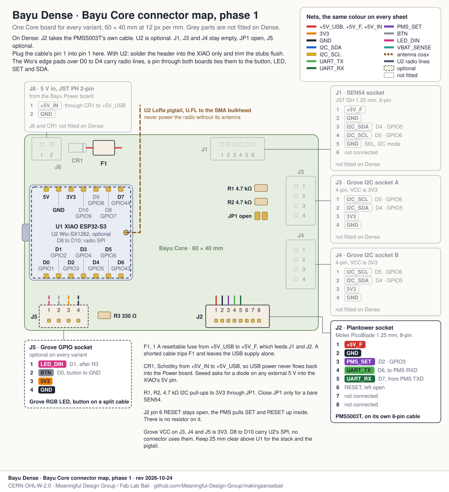
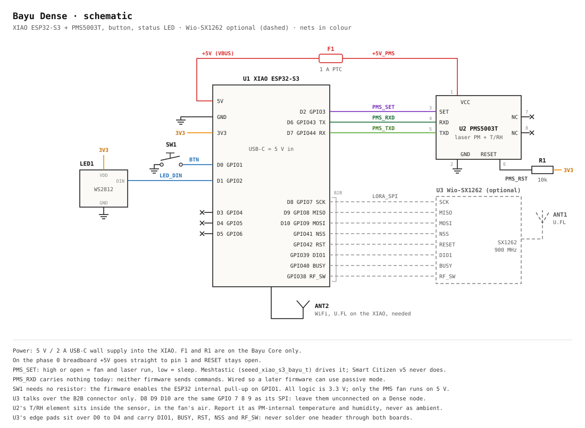

# Bayu Dense

The Dense node is the cheap one, the one participants take home from a workshop and hang on their kos room, their warung or the family compound. A XIAO ESP32-S3 and a Plantower PMS5003T, on WiFi, powered from a 5 V wall plug. The Wio-SX1262 LoRa board is optional, for places the WiFi doesn't reach. Residents hang it themselves, so the wiring has to be easy to follow and the placement rules have to work without English.

It runs the Bayu fork of Meshtastic (`seeed_xiao_s3_bayu_t`), and the Smart Citizen firmware v5 reads it too. The full design is in `../../DESIGN.md`.

## Wiring on a breadboard (phase 0)

Five wires go to the sensor: 5 V, GND, D7 from the sensor's TXD, D6 to its RXD, and D2 to SET. Pins 6, 7 and 8 stay open. The button and LED are extras that only the Meshtastic build uses. Plug in the WiFi antenna that comes with the XIAO, the plain XIAO has no antenna on the board.

On a Grove Shield instead of a breadboard the nets are the same. SET still needs its own wire to D2.

If you add the LoRa board, solder the header into the XIAO only and trim the stubs flush on the side the Wio clips onto. The Wio board has its own row of pads under D0 to D4, and they carry the radio's DIO1, BUSY, RST, NSS and RF_SW lines. One pin through both boards, or a long stub touching a pad, ties the button, the LED, SET and the radio together.

## On the Bayu Core board (phase 1)

The Core isn't routed yet, so where the connectors sit on the board may change. The pin-to-net map won't. The PMS5003T's own cable plugs straight into the PicoBlade socket. SEN54, the Grove I2C sockets and the 5 V input stay empty on a Dense node.

## Schematic

## Pins

| XIAO | GPIO | Net | Goes to | Used by |
|---|---|---|---|---|
| 5V | VBUS | +5V | PMS pin 1 VCC (through F1 on the Core) | both firmwares |
| GND | | GND | PMS pin 2, button, LED | both |
| 3V3 | | 3V3 | LED VDD, R1 on the Core | |
| D2 | 3 | PMS_SET | PMS pin 3 SET. High or open = running, low = asleep | Meshtastic |
| D6 | 43 | PMS_RXD | PMS pin 4 RXD (XIAO TX) | opened by Meshtastic, nothing sent yet |
| D7 | 44 | PMS_TXD | PMS pin 5 TXD (XIAO RX) | both |
| D0 | 1 | BTN | button to GND, internal pull-up | Meshtastic |
| D1 | 2 | LED_DIN | WS2812 data in | Meshtastic |
| D8, D9, D10 | 7, 8, 9 | LORA_SPI | Wio-SX1262 through the B2B connector | leave free |
| — | 38 to 42 | LoRa control | Wio-SX1262 through the B2B connector, no castellated pin | |
| D3, D4, D5 | 4, 5, 6 | | not used on Dense | |

PMS pin 6 (RESET) is left open on the breadboard and pulled up with 10 kΩ on the Core. Pins 7 and 8 aren't connected inside the sensor.

## Parts

Prices are from the cost table in DESIGN.md, October 2026, single units. Search terms are for Tokopedia.

| Qty | Part | Search for | USD | Notes |
|---|---|---|---|---|
| 1 | Seeed XIAO ESP32-S3, plain | `XIAO ESP32S3` | 7.5 | Comes with the WiFi antenna you need. |
| 1 | Plantower PMS5003T with its cable | `PMS5003T` | 18 to 25 | Rare locally, often listed under the PMS5003. Check the label says 5003**T**. |
| 1 | half-size breadboard and jumper wires | `breadboard 400` | | Phase 0 only. |
| 1 | Bayu Core board, connectors | | 8 | Phase 1, replaces the breadboard. |
| 1 | 6 × 6 mm push button | `push button 6x6` | | Optional. |
| 1 | WS2812 single-LED module | `WS2812 modul` | | Optional, powered from 3V3. |
| 1 | 5 V / 2 A USB-C wall charger and cable | anywhere | 5 | Not a laptop port, it can't run the fan. |
| 1 | printed enclosure, PETG or ASA | Fab Lab Bali | 7 | |
| — | coating, mesh, cable ties | | 3 | |
| | **Total, WiFi only** | | **about 52** | |
| 1 | *Optional:* Wio-SX1262 for XIAO and a 900 MHz U.FL antenna | `Wio-SX1262` | 6 | Buy it as the kit with a XIAO, which is also the only way it's sold locally. Brings a Dense node to about 58. |

## Where to hang it

The same rules, in words:

- **Shade:** under an eave or on a wall the sun doesn't hit for most of the day. Sun on the case heats the air the fan pulls in.
- **1.5 to 3 m up:** above head height, on a wall or on a post with two cable ties.
- **A hand's width off the wall:** at least 10 cm on a bracket, with a metre of open air around the intake. Air trapped against a sunny wall is warmer and moves less than the air of the street.
- **Inside the drip line:** at least 30 cm in from where water falls off the roof, so rain doesn't run into the intake.
- **5 m from smoke and heat:** a kitchen vent, a genset, a mosquito coil, an AC outlet, where people smoke or grill. If one of those is what you want to measure, go close on purpose and put it in the node's name, so nobody reads it as the neighbourhood's air.
- **Cable with a drip loop:** let the USB cable hang lower than the case before it goes up to the socket, so water drips off the loop. The socket has to be covered.
- **First week next to a reference:** every new Dense node spends its first seven days within a metre of an Anchor or a Smart Citizen Kit, at the same height. That week gives the correction its data. Then it moves to its own spot.

Inside the case, the PMS sits in its own sealed corner, away from the XIAO. It sucks in low through a short side port with down-facing louvres and mesh. It blows out higher, with a fin between the two ports so it doesn't breathe its own exhaust. Node V2 pulled air through a grille underneath and caught pollution peaks late, so the intake goes on the side here.

The PMS5003T's temperature and humidity come from inside the sensor, in the fan's air, a few degrees warm. We publish them as indicative and never as air temperature. Real air temperature needs an SHT40 in a radiation shield, which the Anchor and Indoor roles have.

## What I checked, and what turned out different

I checked every fact in the drawings against a source before drawing it. Most held, these didn't or needed a note:

1. **The LoRa board does take three D pins.** The Wio-SX1262 shares SPI on GPIO 7, 8 and 9, which are also the XIAO's D8, D9 and D10. Nothing else can go on those three pins when LoRa might be fitted. The control lines (GPIO 38 to 42) only reach it through the B2B connector, as DESIGN.md says.
2. **How the stack mounts.** The Wio-SX1262 clips onto the XIAO's B2B connector, and Seeed's photos show the stack with a header on the XIAO only, sitting in a Grove Shield, so it plugs into a breadboard and into the Core. The B2B connector is on the XIAO's front, next to the WiFi U.FL, so the Wio rides on top. Its edge pads sit over the XIAO's D0 to D4 and carry radio lines (the Relay session found this in Seeed's schematic), so the header goes into the XIAO alone, stubs trimmed flush before the Wio goes on. The LoRa U.FL is on the Wio board. The XIAO's WiFi U.FL ends up between the two boards, and the plain XIAO has no antenna of its own, so the WiFi pigtail has to be routed out of the stack.
3. **Nothing is sent on D6 today.** The Meshtastic driver opens the UART with TX on GPIO43 but never writes to it. v5 opens it RX only. D6 is wired so a later firmware can use the sensor's passive mode.
4. **SET is safe to leave alone.** Plantower's manual says high or floating is normal running. A v5 node with D2 wired but never driven keeps the fan on, which is what v5 expects.
5. **The PMS5003T pinout comes from the PMS5003 manual.** I found no PMS5003T manual. Plantower's PMS5003 manual v2.3 gives the 1 to 8 table, the 3.3 V logic and the ≤ 100 mA, and PyPMS lists the T with the same 8-pin connector. The manual doesn't state the 1.25 mm pitch, that figure is from sellers and DESIGN.md. Check pin 1 and the pitch on the first sensor before ordering a batch of PicoBlade cables.
6. **The button and LED are Meshtastic only.** v5 uses the XIAO's own BOOT button on GPIO0 and has no WS2812 code.
7. **The WS2812 on 3V3.** The WS2812B is specified from 3.5 V. On 3V3 most of them light fine and the data line is then in spec. Fed from 5 V, the LED wants at least 3.5 V on its data pin and a 3.3 V GPIO doesn't get there.
8. **The XIAO 5V pin is USB VBUS**, as Seeed's pin map says. Seeed asks for a diode if 5 V is ever fed into that pin from outside, which matters for the Core's 5 V input and doesn't touch Dense.
9. **"Intakes facing down" in the kit1-hex spec** means down-facing louvres on a side wall, under the hood's skirt. It doesn't mean an intake under the floor, which is what Node V2 had. The section draws the side version.
10. **The distances are ours.** The 1.5 to 3 m height comes from the DIY node's setup guide. The 5 m, 1 m, 30 cm and 10 cm are a first proposal for this drawing. They don't come from a standard and haven't been tested in the field yet, so treat them as a starting point. Plantower's manual only asks for at least 20 cm above the ground and a baffle between inlet and outlet.

## Sources

- Firmware pins: `variants/esp32s3/seeed_xiao_s3_bayu/variant.h` and `src/modules/Telemetry/Sensor/PMS5003Sensor.cpp` on the `bayu` branch of [Meaningful-Design-Group/firmware](https://github.com/Meaningful-Design-Group/firmware); [`../../../diy-node/firmware/diy_node_v5/diy_node_v5.ino`](../../../diy-node/firmware/diy_node_v5/diy_node_v5.ino).
- [Seeed wiki, XIAO ESP32S3 and Wio-SX1262 kit](https://wiki.seeedstudio.com/wio_sx1262_with_xiao_esp32s3_kit/): pin map, extension board drawing, stack photos.
- [Seeed wiki, XIAO ESP32S3 getting started](https://wiki.seeedstudio.com/xiao_esp32s3_getting_started/): 5V = VBUS, diode note.
- [Plantower PMS5003 manual v2.3 (AQ-SPEC copy)](https://www.aqmd.gov/docs/default-source/aq-spec/resources-page/plantower-pms5003-manual_v2-3.pdf): pin definition, power, installation notes.
- [PyPMS sensor table](https://github.com/avaldebe/PyPMS/blob/master/docs/sensors/Plantower.md): PMS5003T connector.
- Node V2 airflow lesson: [`../../../diy-node/enclosure/node-v2/`](../../../diy-node/enclosure/node-v2/). Zoning rules: [`../../../kit1-hex/SPEC_KIT1_HEX.md`](../../../kit1-hex/SPEC_KIT1_HEX.md).
