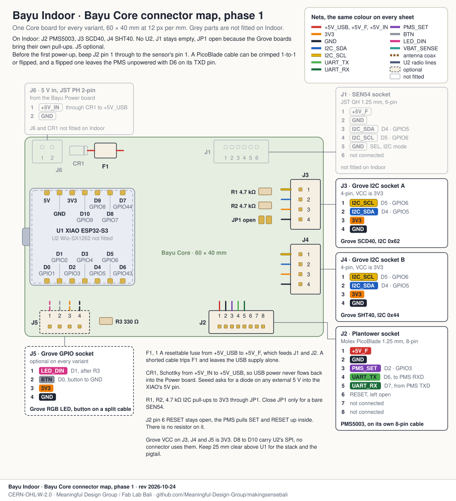
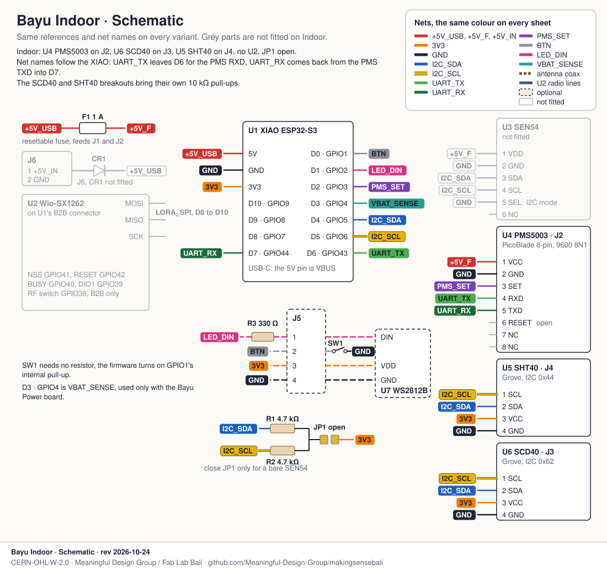

# Bayu Indoor, circuit and placement

Bayu Indoor is the classroom and kos-room node of the [Bayu set](../../DESIGN.md): a Seeed XIAO ESP32-S3 with a Plantower PMS5003 for PM, a Sensirion SCD40 for CO₂ and an SHT40 for temperature and humidity. WiFi only, powered from a 5 V USB wall supply. It is there for ventilation and indoor smoke, a kos room with a mosquito coil burning, a full classroom with the door shut.

Phase 0 is a breadboard. Phase 1 is the same circuit on the Bayu Core carrier board. Both are drawn here, plus the schematic and a sheet on where to put the node in a room, which matters as much as the wiring.

## Wiring on a breadboard (phase 0)

The XIAO straddles the centre channel with its USB-C to the left. The top rails carry `+5V_USB` and GND, the bottom rails 3V3 and GND, and the sensors sit below the board, each taking its power from the rail straight above the pin. The SCD40 and SHT40 take 3V3, the PMS5003 takes 5 V for its fan and laser, and all three share one ground.

Most SCD40 and SHT40 breakouts already carry 10 kΩ pull-ups on SDA and SCL. With two of them on the bus you get 5 kΩ, which is fine at 100 kHz, so don't add more. The XIAO has none of its own, so a bare sensor without a breakout needs 4.7 kΩ to 3V3. To check, measure SDA to VCC on the breakout, about 10 kΩ means the pull-up is there.

## The same circuit on the Bayu Core board (phase 1)

The PMS5003 plugs into the 8-pin PicoBlade (J2), the SCD40 and SHT40 into the two Grove I2C sockets (J3, J4). Grove VCC is 3V3 on this board. The pull-up jumper JP1 stays open on Indoor because the Grove boards bring their own. The SEN54 socket J1, the power input J6 and the Wio-SX1262 (U2) are left empty.

Before the first power-up, beep J2 pin 1 through to pin 1 on the sensor. A PicoBlade cable can be crimped 1-to-1 or 1-to-8, and a flipped one leaves the PMS unpowered with D6 driving its TXD pin.

## Schematic

## Pins

| XIAO pin | GPIO | Net | Goes to | Notes |
|---|---|---|---|---|
| 5V | VBUS | `+5V_USB` | PMS5003 pin 1 VCC | through F1 (1 A) on the Core, where it becomes `+5V_F`, a wire on the breadboard |
| 3V3 | LDO out | `3V3` | SCD40 VCC, SHT40 VCC | regulator rated 700 mA |
| GND | | `GND` | everything | |
| D4 | GPIO5 | `I2C_SDA` | SCD40 SDA, SHT40 SDA | SCD40 at 0x62, SHT40 at 0x44 |
| D5 | GPIO6 | `I2C_SCL` | SCD40 SCL, SHT40 SCL | |
| D6 | GPIO43 | `UART_TX` | PMS5003 pin 4 RXD | Meshtastic only, see below |
| D7 | GPIO44 | `UART_RX` | PMS5003 pin 5 TXD | 9600 8N1, both firmwares |
| D2 | GPIO3 | `PMS_SET` | PMS5003 pin 3 SET | high or open = running, low = asleep. Meshtastic only |
| D0 | GPIO1 | `BTN` | button to GND | optional, Meshtastic only |
| D1 | GPIO2 | `LED_DIN` | WS2812 DIN, through R3 (330 Ω) | optional, Meshtastic only |

PMS5003 pins 6 (RESET), 7 and 8 stay open. RESET and SET have pull-ups inside the sensor.

## Bill of materials

Prices are from the cost table in [DESIGN.md](../../DESIGN.md), single units, October 2026.

| Qty | Part | Phase | Notes | USD |
|---|---|---|---|---|
| 1 | Seeed XIAO ESP32-S3 | both | | 7.5 |
| 1 | Plantower PMS5003 with its 8-pin PicoBlade cable | both | the plain PMS5003 is enough, T/RH comes from the SHT40 | 15 |
| 1 | SCD40 CO₂ breakout, I2C | both | Grove or STEMMA QT style for phase 1 | 22 |
| 1 | SHT40 breakout, I2C | both | on a 10 to 15 cm tail | 4 |
| 1 | Half-size breadboard and male-female jumpers | 0 | plus a PicoBlade to 2.54 mm adapter, or crimp dupont ends on the PMS cable | |
| 1 | Bayu Core PCB with headers, PicoBlade and two Grove sockets | 1 | JP1 open, J1 and J6 not fitted, J5 optional | 8 |
| 2 | Grove 4-pin cables | 1 | | |
| 1 | 5 V / 2 A USB wall supply and USB-C cable | both | headroom for the WiFi and fan peaks | 5 |
| 1 | Printed shell, PETG | both | sensors at the bottom, PMS in the middle, XIAO on top | 5 |
| | Coating, mesh, screws | both | mask the SCD40 and SHT40 before coating | 3 |
| | | | | **about 70** |

## Placement

Mount it on an inside wall at 1.1 to 1.5 m, seated to standing head height. That is the air people breathe in a classroom or a kos room, and an inside wall keeps the sun off the shell.

Keep it at least 1 m from where people sit or sleep. Breath straight onto an SCD40 reads like a full room. The Welsh Government guidance for schools gives 0.5 m as a minimum, I'd rather double it.

Keep it 1 m from windows and doors, 2 m from the AC and out of its throw, and never under a ceiling fan. Each of these pushes one stream of air past the sensor, and we want to read the whole room.

The stove gets at least 2 m, a mosquito coil or the dupa at an offering shelf 1.5 to 2 m, and the node never goes above any of them. What we want is the smoke once it has spread through the room.

No direct sun, no sun-warmed outer wall, nothing next to a rice cooker or the back of a fridge. Any of these lifts the SHT40 and the SCD40's own temperature compensation.

Inside the shell, from the bottom up: SCD40 and SHT40 in the intake air, then the PMS5003, then the XIAO in its own vented bay. The sensors stay upstream of the PMS exhaust and away from the XIAO's WiFi radio. We lost the temperature channel of a whole node generation to this, see [node-v2](../../../diy-node/enclosure/node-v2/).

The SCD40 reads CO₂ through a membrane, so its bay needs openings on two faces and the membrane stays bare and uncoated. Its automatic self-calibration takes the lowest CO₂ it sees each week as outdoor air, and needs at least three minutes of it. A classroom empty at the weekend does that by itself. A kos room with the AC on and the door shut doesn't, so open the window and the door for ten minutes once a week.

## Firmware

Both firmwares read this wiring, and that is why D6 and D2 are wired even though only one of them uses them.

- **Meshtastic, Bayu fork** ([`seeed_xiao_s3_bayu`](https://github.com/Meaningful-Design-Group/firmware/tree/bayu/variants/esp32s3/seeed_xiao_s3_bayu)): listens on D7, talks on D6, sleeps the PMS fan with D2, button on D0, WS2812 on D1. The SCD40 and SHT40 come up from the I2C scan.
- **Bayu firmware v5** ([`diy_node_v5.ino`](../../../diy-node/firmware/diy_node_v5/diy_node_v5.ino)): finds the SCD4x and SHT4x on I2C and only listens to the PMS on D7. It never drives D6 or D2, so the fan runs all the time, and it uses the XIAO's own BOOT button, not D0.

## Checked against the datasheets

I checked each fact in these drawings against the datasheet or the code before drawing it. These are the ones that didn't match, or needed more words:

- SCD40 peak current: 175 mA is the typical peak at 3.3 V. The maximum is 205 mA at 3.3 V and 137 mA at 5 V (Sensirion SCD4x datasheet v1.7, table 4). The 3V3 budget uses 205 mA: with the ESP32-S3's WiFi transmit peak of about 340 mA it comes to about 550 mA against the regulator's 700 mA. So the SCD40 goes on 3V3, which also keeps SDA and SCL at 3.3 V on every breakout. On 5 V, some breakouts would pull the bus up to 5 V, and the ESP32-S3 pins are not 5 V tolerant.
- SCD40 range: 400 to 2000 ppm is the range where the accuracy is specified, the output goes up to 40 000 ppm. A packed classroom can pass 2000 ppm, and above it the number is less sure. The SCD41 is specified to 5000 ppm if that turns out to matter.
- ASC target: the SCD40 assumes outdoor air is 400 ppm. Outdoor air is closer to 425 ppm now, so an SCD40 on its default reads about 25 ppm low. For ventilation that changes nothing, and if it ever matters the target can be set to 425.
- PMS5003 RESET: DESIGN.md has RESET pulled up on the Core. The Plantower manual v2.3 says SET and RESET are already pulled up inside and should be left unconnected when unused. The resistor can go.
- PMS5003 connector: the Plantower manual draws the 8-pin, 1.25 mm connector and its pinout, which matches, but doesn't name a maker. The cables sold with it fit Molex PicoBlade.
- Button: v5 reads the XIAO's BOOT button (GPIO0), not D0 (GPIO1). D0 is a Meshtastic button only.
- Which firmware: DESIGN.md makes Meshtastic the firmware for new Bayu nodes. For a WiFi-only Indoor node the Bayu firmware v5 also works, and the wiring here suits both. That choice is still open.

Placement distances: seated head height, away from windows and vents, and the 0.5 m minimum from people come from the Welsh Government's CO₂ monitor guidance for schools. The 1 m and 2 m rings are our own rule, set wider than that minimum.
