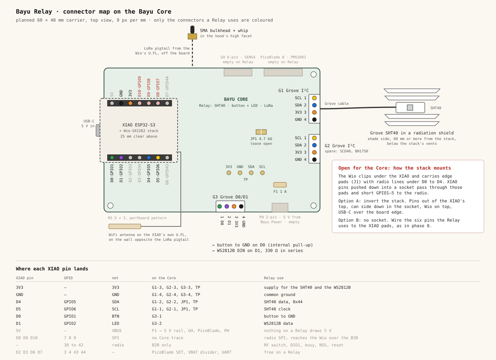
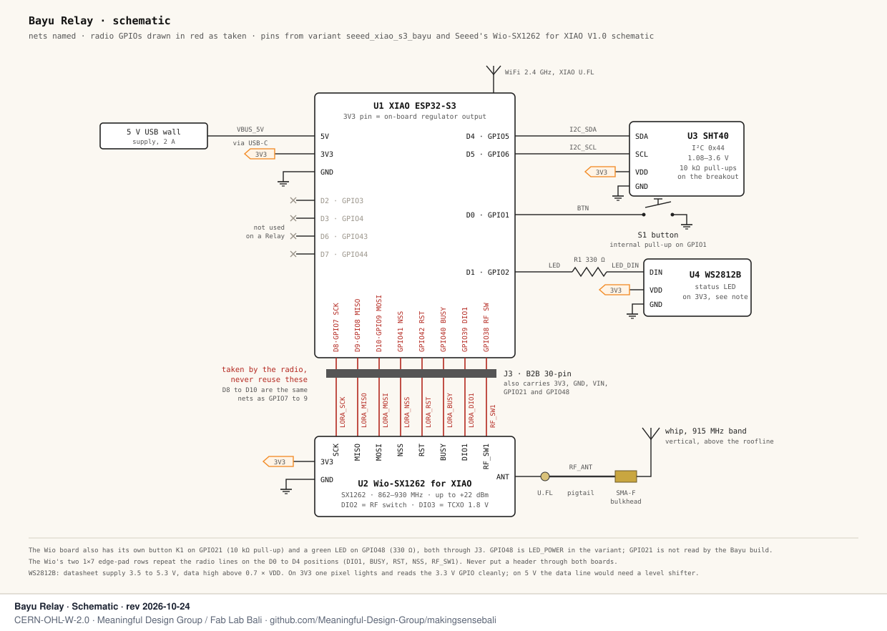

# Bayu Relay wiring and placement

The Relay is the Bayu node with no PM sensor, a XIAO ESP32-S3 with the Wio-SX1262 LoRa board, an SHT40 on a Grove tail, WiFi to a router and 5 V from a USB wall supply. It listens to the cluster's Meshtastic traffic on LoRa and passes it to our MQTT broker over WiFi, and the SHT40 makes it a climate point too. You only need one where the cluster's Anchor has no WiFi; any Anchor or Dense node with WiFi does the same job. The design behind it is in [`../../DESIGN.md`](../../DESIGN.md).

Phase 0 is a breadboard and jumpers, no PCB. The Core drawing shows where the same connections land on the carrier board once we order it.

## Wiring

### Breadboard, phase 0


The stack does **not** plug into the breadboard. The Wio-SX1262 clips under the XIAO on the board-to-board (B2B) connector, and the Wio has two rows of edge pads (J1, J2) right under the XIAO's pins. J1 carries the radio on the D0 to D4 positions, so a header pushed through both boards ties GPIO1–5 to the radio's DIO1, BUSY, RESET, NSS and RF switch lines. The Relay uses D0, D1 and D4, so that would break it on day one.

The way around it is to fit two 1×7 headers from the top of the XIAO, solder them underneath, trim the stubs flush, then clip the Wio on. The stack sits next to the breadboard and female-to-male jumpers carry six pins across. Fit both antennas before you plug in USB.

### On the Bayu Core



The SHT40 goes on Grove socket G1, the button and the LED share the D0/D1 Grove socket G3, and the SEN54 and PMS5003 connectors stay empty. Leave the I²C pull-up jumper JP1 open: Grove and Adafruit SHT40 boards bring their own pull-ups. The LoRa pigtail leaves the board towards the SMA bulkhead, and the WiFi antenna goes on the opposite wall.

The edge-pad problem above also applies to the Core: a socketed XIAO with the Wio underneath has the same short. Two ways out are drawn in the red box, invert the stack in the socket or wire the six pins by hand. We have to decide this before the PCB order.

### Schematic



### Pins

| Function | XIAO pin | GPIO | Breadboard wire | Core |
|---|---|---|---|---|
| SHT40 SDA | D4 | 5 | blue | G1 pin 2 |
| SHT40 SCL | D5 | 6 | yellow | G1 pin 1 |
| SHT40 and LED supply | 3V3 | — | orange | G1, G3 pin 3 |
| Ground | GND | — | black | G1, G3 pin 4 |
| Button to GND, internal pull-up | D0 | 1 | green | G3 pin 1 |
| WS2812B data, through 330 Ω | D1 | 2 | purple | G3 pin 2 |
| Radio SPI: SCK, MISO, MOSI | D8, D9, D10 | 7, 8, 9 | taken | B2B |
| Radio NSS, RESET, BUSY, DIO1, RF switch | — | 41, 42, 40, 39, 38 | taken | B2B only |
| Wio's own button and green LED | — | 21, 48 | on the Wio | B2B only |
| Free on a Relay | D2, D3, D6, D7 | 3, 4, 43, 44 | — | — |

The 3V3 pin is the output of the XIAO's own regulator. Nothing on a Relay needs 5 V beyond the USB input. The SHT40 answers at 0x44.

The WS2812B datasheet asks for 3.5 to 5.3 V, and its data input reads high above 0.7 × VDD. On 3V3 a single pixel lights fine and reads the 3.3 V GPIO cleanly. On 5 V it would need a level shifter on the data line, so I keep it on 3V3.

## Parts

Prices are single units, October 2026, from the cost table in DESIGN.md where it has them.

| Qty | Part | Notes | USD |
|---|---|---|---|
| 1 | XIAO ESP32-S3 & Wio-SX1262 kit (Seeed 102010611) | Buy the kit. It comes with the B2B connector fitted on the XIAO, a LoRa antenna and a WiFi antenna. The kit's flat LoRa antenna is for bench tests only. | 9.90 |
| 1 | SHT40 breakout | Adafruit 4885 on the breadboard, a Grove SHT40 for the Core. Clones work, check the silkscreen for the pin order. | 2 to 6 |
| 1 | U.FL to SMA-female bulkhead pigtail | Short, 10 to 15 cm. | 2 |
| 1 | 915 MHz band whip, SMA-male | Covers 920 to 923 MHz. Kit1-hex is drawn around a 13 × 195 mm whip. | 3 |
| 1 | 6 × 6 mm tactile button | | 0.10 |
| 1 | WS2812B breakout, single pixel | | 0.50 |
| 1 | 330 Ω resistor | In series with the LED data line. | 0.05 |
| 2 | 1×7 male header, 2.54 mm | Soldered from the top of the XIAO only. | 0.20 |
| 1 | Half-size breadboard, female-to-male and male-to-male jumpers | Phase 0 only. | 3 |
| 1 | 5 V / 2 A USB supply and USB-C cable | | 5 |
| 1 | Enclosure with a radiation-shield bay and an SMA boss | Kit1-hex, or any printed box that keeps the radio high and the SHT40 low. | 5 |

That is about USD 28 for the phase-0 build before the enclosure, in line with the USD 40 Relay column in DESIGN.md once the Core PCB and coating are added.

## Where to put it


The whip stands vertical with its tip 1 m or more above the roof ridge. LoRa at 921 MHz wants the space around the straight line between two antennas clear, not only the line itself. That space, the first Fresnel zone, has a radius of about 9 m at the middle of a 1 km link and 13 m on 2 km, so a Relay under the eaves loses most of its reach to its own roof.

Keep the whip 1 m or more from roof sheet, tandon water tanks, steel railings and satellite dishes, and never put a tank between the Relay and the nodes it serves. Metal detunes the antenna and water absorbs at these frequencies.

Point it across open sawah or over the roofs of the banjar, not through a row of coconut palms. Every node of the cluster has to share the same frequency, preset and channels, or it will never hear the Relay at all.

Treat these ranges as a starting guess until we have our own range tests. MEDIUM_FAST reaches roughly 0.3 to 1 km through a village and 1 to 3 km across open sawah. LONG_FAST reaches roughly 0.5 to 1.5 km through a village and 2 to 5 km across open sawah. Seeed quotes 2 to 5 km for the kit. None of this is a legal or measured figure.

The XIAO's WiFi antenna sits inside the box, so the router has to be close, within about 15 m and one wall. Check the signal at the mast with a phone before you drill anything.

The radio warms the air around it when it transmits. We already lost a node generation to that, the Node V2 had its climate sensor sharing air with the radio. So the stack sits high in the box with its vents at the top, and the SHT40 sits low, 60 mm or more away, inside the radiation shield on the shade side. In Bali that is the south face for most of the year, because the sun stays north of overhead from mid-February to late October. The rule comes from [`kit1-hex`](../../../kit1-hex/SPEC_KIT1_HEX.md).

Power comes over USB from a socket indoors, with a drip loop where the cable leaves the mast. Never power the board without the LoRa antenna on, the SX1262 can be damaged transmitting into an open connector.

## Meshtastic settings

Flash the Bayu image, env `seeed_xiao_s3_bayu` from our [fork](https://github.com/Meaningful-Design-Group/firmware/tree/bayu) (see `BAYU.md` there). With no Plantower on the UART the driver gives up after 3 s and the node runs as a plain mesh node with the SHT40 on I²C. The stock `seeed-xiao-s3` image also works, but there the button is the Wio's own one on GPIO21 and the breadboard button on D0 does nothing.

On an ESP32, Meshtastic starts Bluetooth only while WiFi is off. Do everything over USB with the [Meshtastic CLI](https://meshtastic.org/docs/software/python/cli/) (`pipx install meshtastic`), and turn WiFi on last.

Meshtastic has no Indonesia region yet (upstream issue #9782), so we run `MY_919` like the Indonesian community and pin one frequency inside the 920 to 923 MHz class licence band:

```bash
meshtastic --set lora.region MY_919 --set lora.override_frequency 921.5 --set lora.modem_preset LONG_FAST
```

Use `MEDIUM_FAST` instead in a dense village cluster. Every node in the cluster carries the same three values.

For the role use `CLIENT`, which rebroadcasts everything and keeps WiFi up:

```bash
meshtastic --set device.role CLIENT
```

You can also try `CLIENT_BASE` once the cluster's nodes are marked as favourites on the Relay, it gives their packets router priority.

The private `bayu` channel is the primary, with MQTT uplink on. `LongFast` with the default key is the secondary, uplink off, so community traffic gets carried but never reaches our broker. Set them up on one node, then copy the channel URL to the others with `meshtastic --seturl`, since the `bayu` key has to be identical everywhere:

```bash
meshtastic --ch-index 0 --ch-set name bayu --ch-set psk random --ch-set uplink_enabled true
```

```bash
meshtastic --ch-add LongFast
```

```bash
meshtastic --ch-index 1 --ch-set psk default --ch-set uplink_enabled false
```

MQTT to the broker on the NAS, unencrypted payloads so the bridge can read them:

```bash
meshtastic --set mqtt.enabled true --set mqtt.address NAS_IP --set mqtt.username bayu --set mqtt.password BROKER_PASSWORD --set mqtt.root msh/ID --set mqtt.encryption_enabled false
```

The SHT40 reading, every 15 minutes:

```bash
meshtastic --set telemetry.environment_measurement_enabled true --set telemetry.environment_update_interval 900
```

Set WiFi last. After this, reach the node over USB or with `meshtastic --host` on its IP:

```bash
meshtastic --set network.wifi_enabled true --set network.wifi_ssid "SSID" --set network.wifi_psk "WIFI_PASSWORD"
```

Leave `lora.tx_power` at the default until someone has read the Indonesian class licence limit. `MY_919` allows up to 27 dBm in the firmware table, which says nothing about what is legal here.

## Corrections to DESIGN.md

These came up while checking the drawings against the Seeed schematic and the firmware source. DESIGN.md is not changed here.

1. The radio does take D pins. GPIO 7, 8 and 9 are the same nets as D8, D9 and D10, so the SPI bus uses those three pins even though it reaches the Wio through the B2B connector. The pin budget table in DESIGN.md already says so; the sentence "every D pin is still available" does not hold for D8 to D10.
2. No header through both boards. The Wio's edge pads J1 carry the radio on the D0 to D4 positions (Seeed schematic "Wio-SX1262 for XIAO V1.0"; it is also Meshtastic's `SEEED_XIAO_NRF_WIO_BTB` pinout). Phase 0 "on the Grove Shield" and a "socketed XIAO" on the Core both need the stack mounted another way. See the Core drawing.
3. `ROUTER_CLIENT` is gone. It is deprecated in the protobufs, and `AdminModule.cpp` silently turns it into `CLIENT`. `ROUTER` and `ROUTER_LATE` force power saving in `PowerFSM.cpp`, which puts WiFi to sleep, so neither fits a WiFi Relay. Use `CLIENT`.
4. MQTT JSON was removed in firmware 2.8.0. `mqtt.json_enabled` is ignored and the firmware only publishes protobuf on `msh/ID/2/e/<channel>/<node>`. The `msh/ID/2/json/bayu/#` topic in DESIGN.md will stay empty. `bayu-bridge` has to decode the `ServiceEnvelope` protobuf, with `mqtt.encryption_enabled false` so the packet inside arrives decoded.
5. Bluetooth stops when WiFi starts. Provisioning over Bluetooth only works until WiFi is set. After that it is USB or the node's IP.
6. Buy the kit. The B2B connector is on the XIAO's underside, and a Seeed forum thread reports that plain XIAO ESP32-S3 boards ship without it fitted. The kit at USD 9.90 is also cheaper than the XIAO plus the Wio priced separately in the cost table.
7. The Wio has a button and an LED of its own. Button K1 on GPIO21 and a green LED on GPIO48, both through the B2B connector. That is why the stock variant has `BUTTON_PIN 21` and `LED_POWER 48`. The Bayu build moves the button to D0, so the Wio's button does nothing there.
8. The secondary `LongFast` only meets nodes on the same radio settings. All channels share the primary's frequency and preset, so with the frequency pinned at 921.5 MHz our Relays carry community traffic only from nodes pinned to the same frequency and preset.
9. Wio-SX1262 band. The kit wiki says 862 to 930 MHz. The module page says 868 to 915 MHz in one place and 868 to 960 MHz in another. 920 to 923 MHz sits inside all three.

Checked and correct: the radio GPIOs (41 NSS, 42 reset, 39 DIO1, 40 busy, 38 RF switch) in `variants/esp32s3/seeed_xiao_s3_bayu/variant.h`, I²C on D4/D5, button on D0, LED on D1, SHT40 on 3.3 V at 0x44 (the SHT40-AD1B part, Adafruit's board uses it).

## Sources

- Seeed, [XIAO ESP32S3 & Wio-SX1262 kit wiki](https://wiki.seeedstudio.com/wio_sx1262_with_xiao_esp32s3_kit/) and [schematic](https://files.seeedstudio.com/products/SenseCAP/Wio_SX1262/Schematic_Diagram_Wio-SX1262_for_XIAO.pdf)
- [espboards.dev kit page](https://www.espboards.dev/esp32/seeed-xiao-esp32s3-wio-sx1262-kit/), on not soldering one header through both boards
- Meshtastic firmware on our `bayu` branch (v2.8.2 base): `variant.h`, `protobufs/meshtastic/config.proto`, `module_config.proto`, `src/modules/AdminModule.cpp`, `src/PowerFSM.cpp`, `src/mqtt/MQTT.cpp`, `src/platform/esp32/main-esp32.cpp`
- Adafruit, [SHT40 breakout pinouts](https://learn.adafruit.com/adafruit-sht40-temperature-humidity-sensor/pinouts)
- Sensirion SHT4x datasheet; Worldsemi WS2812B datasheet
