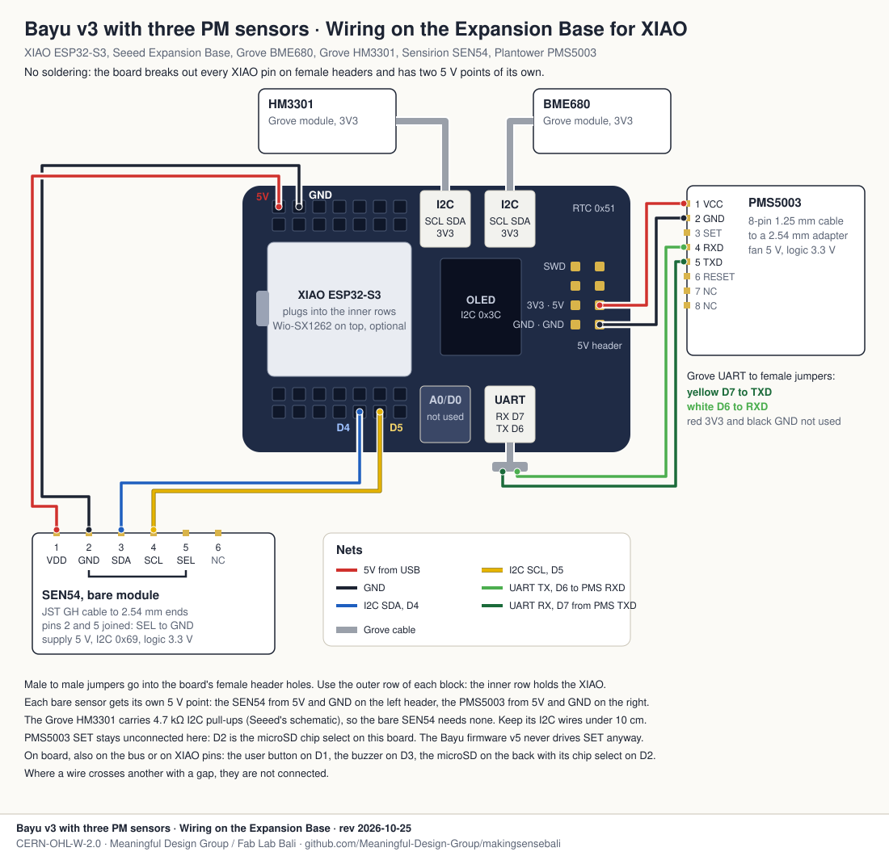

# Bayu on the Expansion Base for XIAO

How Bayu goes together on Seeed's [Expansion Base for
XIAO](https://wiki.seeedstudio.com/Seeeduino-XIAO-Expansion-Board/) instead of the Grove Shield.

The Expansion Base has the four Grove sockets Bayu uses: two I2C, one UART and one A0/D0.
It also carries a PCF8563 clock with a coin cell, a microSD slot, a 0.96" OLED, a user
button, a buzzer, a battery charger and a header with 5V and GND on male pins. The repo
already has a Bayu build for it, the [display build](../../diy-node/firmware/diy_node_display/),
which shows the readings on the OLED and logs them to the microSD with no network at all.

Every Grove socket on this board is powered at 3V3, as on the Grove Shield.

## What the board gives Bayu

| XIAO pin | On the Expansion Base | In Bayu |
|---|---|---|
| D0 | A0/D0 Grove socket | button, Meshtastic build only |
| D1 | user button | status LED, Meshtastic build only |
| D2 | microSD chip select | PMS5003 SET, Meshtastic build only |
| D3 | buzzer, can be cut off | battery sense, Power board only |
| D4, D5 | both I2C sockets, the OLED at 0x3C, the clock at 0x51 | I2C for every sensor |
| D6, D7 | UART socket, and RX and TX on the right header | the Plantower |
| D8 to D10 | microSD SPI | the Wio-SX1262's SPI, on its own chip select |

The Bayu firmware v5 only uses I2C and D7, so it runs on this board unchanged. The three
clashes on D1, D2 and D3 only matter for the Meshtastic build and the solar Power board.
None of the bus addresses collide: OLED 0x3C, HM3301 0x40, clock 0x51, SEN54 0x69, BME680
0x76 or 0x77.

## Bayu v3

Two Grove cables and nothing else: the Grove BME680 in one I2C socket, the Grove HM3301 in
the other. It is the same node as on the Grove Shield, with a display and a log on top.

## Bayu v3 with three PM sensors, no soldering

The Grove HM3301 and BME680 keep their sockets. The bare SEN54 and the PMS5003 go on jumper
wires, and each takes 5 V from its own point on the board, so there is no breadboard and no
soldering. Use the outer row of each female header block: the inner row holds the XIAO.

| From | To | Wire |
|---|---|---|
| Grove HM3301 | I2C socket | Grove cable |
| Grove BME680 | the other I2C socket | Grove cable |
| Left header 5V | SEN54 pin 1 VDD | red, male to female |
| Left header GND | SEN54 pin 2 GND, joined to pin 5 SEL in the plug | black, male to female |
| Bottom header D4 | SEN54 pin 3 SDA | blue, male to female |
| Bottom header D5 | SEN54 pin 4 SCL | yellow, male to female |
| Right header 5V | PMS5003 pin 1 VCC | red, female to female |
| Right header GND | PMS5003 pin 2 GND | black, female to female |
| UART socket, yellow wire (D7) | PMS5003 pin 5 TXD | Grove to female jumper cable |
| UART socket, white wire (D6) | PMS5003 pin 4 RXD | same cable |

The UART cable's red and black wires stay unconnected. PMS5003 SET stays open, because D2
is the microSD chip select here, and the Bayu firmware v5 never drives SET anyway. The Grove
HM3301 carries 4.7 kΩ I2C pull-ups, as Seeed's
[schematic](https://wiki.seeedstudio.com/Grove-Laser_PM2.5_Sensor-HM3301/) shows, so the
SEN54 needs none. Keep the SEN54's I2C wires under 10 cm.

The 5 V on both headers is USB 5 V. On battery alone the board has no 5 V rail, so the bare
SEN54 and the PMS5003 only run while USB is plugged in.

## Plug-in version, with adapter leads

The [Grove adapter leads](../grove/v3-three-pm/#plug-in-version-grove-adapter-leads) work
here too. Put the Grove HM3301 in one I2C socket and a Grove I2C hub in the other, carrying
the BME680 and lead A for the SEN54. Lead B for the PMS5003 goes in the UART socket. The
3V3 budget on that page applies, with a few milliamps more for the OLED.

## Other Bayu variants

| Variant | I2C socket | I2C socket | UART socket | 5 V |
|---|---|---|---|---|
| Anchor | SEN54, Grove version or lead A | SHT40 | PMS5003 on lead B | from the leads, or a header wire |
| Dense | | | PMS5003T on lead B | from the lead, or a header wire |
| Indoor | SCD41, Grove | SHT40 | PMS5003 on lead B | from the lead, or a header wire |
| Relay | SHT40 | | | not needed |

With the Wio-SX1262 on the XIAO, the microSD and the radio share the SPI bus on separate
chip selects. Solder the XIAO's header into the XIAO only and trim the stubs, as for every
Bayu with LoRa.

## Firmware

The [Bayu firmware v6](../../diy-node/firmware/diy_node_v6/) finds this board on its own:
the OLED answers at 0x3C and the clock at 0x51, which a Grove Shield never does. On the
Expansion Base it shows the Fab City logo at boot, then the readings, sounds the buzzer when
PM2.5 reaches Tidak Sehat on Indonesia's ISPU scale, logs every reading to the microSD and
keeps time on the clock when offline. The same firmware on a Grove Shield behaves like v5.
The flasher at planetai.fab.city/sensors installs it.

## Before you choose this board

- It is bigger than the Grove Shield, about half a Raspberry Pi 4, and the node-v3.2
  enclosure has no bracket for it. For now it is a bench, indoor or display node.
- The OLED and the microSD are only used by the display build. The Bayu firmware v5
  publishes over WiFi and leaves them off.
- Nothing on this page has been built with three PM sensors yet.
