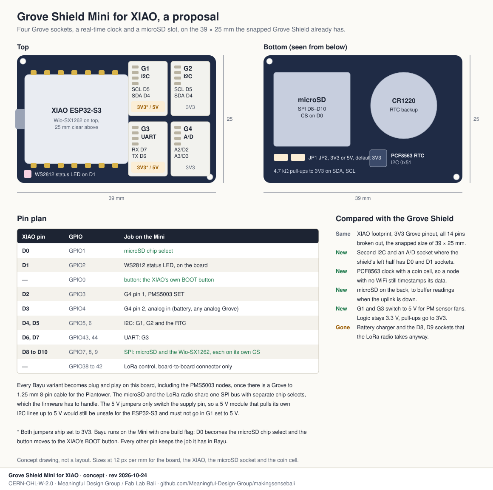

# Grove Shield Mini for XIAO

A proposal to Seeed Studio, from the Making Sense Bali team at Fab City.

## Why I'm asking for it

Fab Lab Bali builds our Bayu air quality nodes on a XIAO ESP32-S3 and your Grove Shield
for XIAO, with a Grove BME680 and a Grove HM3301, or on a PCB of our own when the shield
is out of stock. The shield works, and it is why someone at a workshop can build a node
in an afternoon without soldering. But six of its eight sockets sit empty in every node,
and what we keep wishing it had is not on it.

A node in the field needs a clock that keeps time when there is no WiFi, and somewhere to
store readings when the uplink drops. Particulate sensors also want 5 V for their fans,
which no socket on the shield gives. Meanwhile the battery charger goes unused, and the D8
and D9 sockets are lost as soon as the LoRa radio goes on, because it takes those pins.

So I'd like a smaller board with four sockets, a clock and a microSD slot, and that's it.

## The board

The size is the one your Grove Shield already has when you snap it in half, 39 × 25 mm,
with the XIAO on the left and four sockets on the right.

- **G1, I2C**, on D4 and D5, with a solder jumper to switch its supply from 3V3 to 5 V.
- **G2, I2C**, on D4 and D5, at 3V3.
- **G3, UART**, on D6 and D7, with the same 3V3 or 5 V jumper.
- **G4, analog and digital**, with A2/D2 on pin 1 and A3/D3 on pin 2, at 3V3.
- **A PCF8563 real-time clock** on the I2C bus at 0x51, with a CR1220 holder, like the one
  on your XIAO Expansion Board.
- **A microSD slot** on the back, on the SPI pins D8 to D10, with chip select on D1.
- **A user button** on D0, 4.7 kΩ I2C pull-ups to 3V3, pads for all 14 XIAO pins plus 5V,
  3V3 and GND, and two M2 holes.

That is three digital sockets, counting the two I2C and the UART, and one analog. Every
Bayu sensor is digital, so the analog socket earns its place another way. Pin 1 drives the
Plantower's SET line, so the fan sleeps between readings, and pin 2 reads a battery
divider or any analog Grove module.

The 5 V jumpers switch only the supply pin, never the signal lines. That is what lets a
Sensirion SEN54 or a Plantower PMS5003 run its fan from a Grove socket while the ESP32-S3
keeps 3.3 V logic. It still means a 5 V module that pulls its own I2C lines up to 5 V must
never go in G1 on 5 V, and that should be printed on the silkscreen.

## What it must keep working

- **The Wio-SX1262 stack:** the XIAO ESP32-S3 and Wio-SX1262 kit has to sit on it with
  25 mm of clear height and a free path for both U.FL pigtails. The radio and the microSD
  share the SPI bus on separate chip selects, which needs care in the firmware, and we will
  do that part in our Meshtastic fork.
- **The XIAO family:** it should take a XIAO ESP32-C3 as well, as the Grove Shield does,
  since our firmware runs on both.
- **The Grove Shield's pins** for I2C, UART and D0, so a node moves from one
  board to the other without a firmware change.

## Next to the board

- A Grove to 1.25 mm 8-pin cable for the Plantower PMS5003 family. It is one of the most
  used low-cost PM sensors in citizen science, and it is the one module in our kit that
  can't plug in today.
- A Grove SCD40. Your Grove CO2 sensors are the SCD30 and the SCD41, and for classrooms
  the SCD40's range is enough at about a third of the price.

## What we bring

We bring the deployment and the documentation. Every Bayu variant on this board is drawn
and checked in this repository, with wiring, placement and firmware, and it would go
into the Fab City kit we are shaping with you. The first boards would be tested in Bali,
where Bayu is already deployed, then go to the other Fab Cities interested in the kit.

## How it maps to Bayu

| Variant | G1 I2C | G2 I2C | G3 UART | G4 A/D |
|---|---|---|---|---|
| Bayu v3, deployed | BME680 | HM3301 | | |
| Anchor | SEN54, at 5 V if bare | SHT40 | PMS5003, at 5 V | PMS5003 SET |
| Dense | | | PMS5003T, at 5 V | PMS5003T SET |
| Indoor | SCD40 or SCD41 | SHT40 | PMS5003, at 5 V | PMS5003 SET |
| Relay | SHT40 | | | battery sense on solar sites |

Every row is plug and play on the Mini. On today's Grove Shield, only Bayu v3 and the
Relay are. See [Bayu on the Grove Shield](../grove/) for the comparison.
