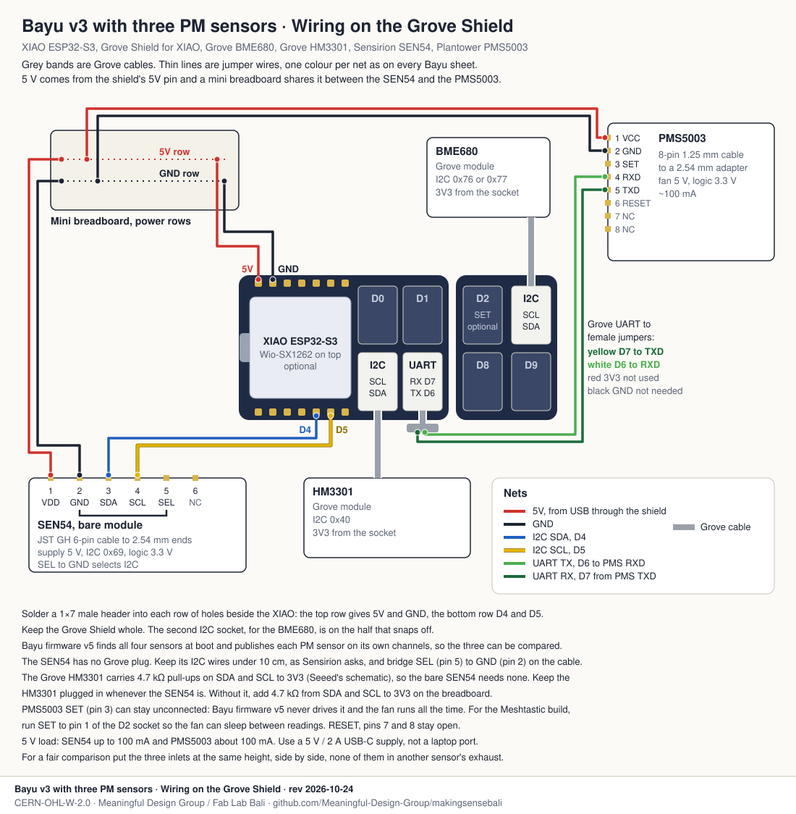

# Bayu v3 with three PM sensors

The Bayu v3 we have in the field, a XIAO ESP32-S3 on the Seeed Grove Shield with a Grove
BME680 and a Grove HM3301, plus two more particulate sensors on the same board: a bare
Sensirion SEN54 and a Plantower PMS5003. Three PM sensors breathing the same air, read by
the same node.

It is a comparison node. Put it next to a Smart Citizen Kit or a reference station and it
shows how the HM3301 we deployed, the SEN54 and the PMS5003 read Bali's air side by side,
through the rice-burning season and the wet months. That is the comparison we need before
choosing the PM sensor for the next nodes.

## Connections

| From | To | Wire |
|---|---|---|
| Grove HM3301 | Grove Shield I2C socket, left half | Grove cable |
| Grove BME680 | Grove Shield I2C socket, right half | Grove cable |
| Shield 5V pin | breadboard 5V row | red jumper |
| Shield GND pin | breadboard GND row | black jumper |
| Breadboard 5V row | SEN54 pin 1 VDD | red jumper |
| Breadboard GND row | SEN54 pin 2 GND | black jumper |
| SEN54 pin 5 SEL | SEN54 pin 2 GND | bridged on the cable |
| Shield D4 pin | SEN54 pin 3 SDA | blue jumper |
| Shield D5 pin | SEN54 pin 4 SCL | yellow jumper |
| Breadboard 5V row | PMS5003 pin 1 VCC | red jumper |
| Breadboard GND row | PMS5003 pin 2 GND | black jumper |
| Shield UART socket, yellow wire (D7) | PMS5003 pin 5 TXD | Grove to female jumper cable |
| Shield UART socket, white wire (D6) | PMS5003 pin 4 RXD | same cable |
| Shield D2 socket, yellow wire | PMS5003 pin 3 SET | optional, Meshtastic build only |

The UART cable's red wire carries 3V3 and stays unconnected, because the PMS5003 fan needs
5 V. Its black wire is not needed, since the PMS5003 already has ground from the
breadboard. PMS5003 pins 6, 7 and 8 and SEN54 pin 6 stay open.

## What you need

On top of a Bayu v3 built on the Grove Shield:

| Qty | Part | Notes |
|---|---|---|
| 1 | Sensirion SEN54, the bare module | With a 6-pin JST GH cable that ends in 2.54 mm female plugs. |
| 1 | Plantower PMS5003 | With its 8-pin 1.25 mm cable and a 2.54 mm adapter board. |
| 1 | Grove to 4-pin female jumper cable | For the UART socket. A second one if you wire SET. |
| 1 | Mini breadboard, 170 holes | Used only as a 5 V and GND junction. |
| 2 | 1 × 7 male header, 2.54 mm | Soldered into the shield's breakout holes. |
| 8 | Male to female jumper wires, 10 cm | Keep the SEN54's I2C pair short. |
| 1 | 5 V / 2 A USB-C supply | Not a laptop port. |

Prices and sources for the SEN54 and the PMS5003 are in the [Bayu bill of
materials](../../bom.csv).

## Building it

1. Solder a 1 × 7 male header into each row of holes beside the XIAO on the Grove Shield,
   pins up. The top row gives you 5V and GND, the bottom row D4 and D5. Keep the shield
   whole: the second I2C socket is on the half that snaps off.
2. Plug in the Grove HM3301 and the Grove BME680 as on any Bayu v3.
3. Push the mini breadboard next to the shield. Run 5V and GND from the header into its two
   power rows.
4. Wire the SEN54: VDD and GND from the breadboard, SDA to D4 and SCL to D5. Bridge SEL to
   GND on the cable. Keep the SDA and SCL wires under 10 cm.
5. Wire the PMS5003: VCC and GND from the breadboard, then the Grove to jumper cable from
   the UART socket, yellow to TXD and white to RXD.
6. Before powering it, check the I2C pull-ups. With the board unpowered, measure SDA to
   3V3. About 10 kΩ or less means the Grove modules bring pull-ups. If you read open
   circuit, add 4.7 kΩ from SDA and from SCL to 3V3 on the breadboard.
7. Power it from the USB-C supply and open the node's status page. The boot inventory
   should list BME680, HM3301, SEN54 and PMS5003.

## Firmware

The [Bayu firmware v5](../../../diy-node/firmware/diy_node_v5/) finds all four sensors at
boot with no setting to change. It publishes each PM sensor on its own channels, so the
three readings arrive side by side on the platform. It only listens to the PMS5003 on D7
and never drives SET, so the PMS5003 fan runs all the time.

The Meshtastic Bayu build also reads all three, and it can sleep the PMS5003 fan through
the SET wire to the D2 socket.

## Where to put it

For a fair comparison, the three inlets sit at the same height, side by side, and none of
them breathes another sensor's exhaust. The rules on the
[Anchor placement sheet](../../circuits/anchor/placement.svg) apply. The node-v3.2
enclosure only holds the HM3301, so for now this node needs its own housing.

## Still to check

- That the bus reads cleanly with three PM sensors on it. The SEN54 asks for short leads,
  and the HM3301 and BME680 sit on Grove cables.
- The 3V3 supply. The HM3301 runs from the socket's 3V3, as on every Bayu v3, and the
  node-v3.2 notes still say it needs 5 V. Running this node is also a good way to settle
  that.
- Nothing on this page has been built yet.
