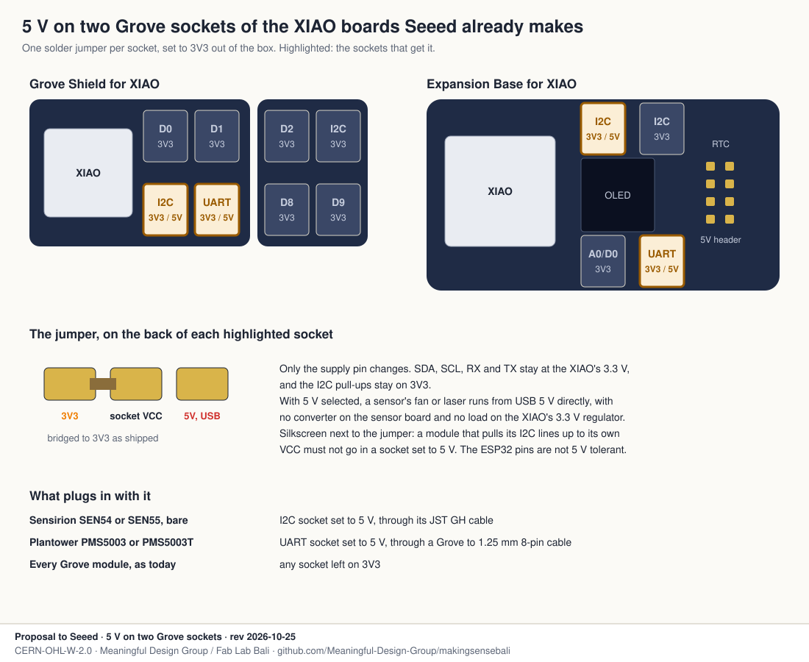

# 5 V on the Grove sockets of the XIAO boards

A proposal to Seeed Studio, from the Making Sense Bali team at Fab City.

## Why I'm asking

Fab Lab Bali builds our Bayu air quality nodes on the XIAO ESP32-S3 with your Grove Shield
for XIAO, a Grove BME680 and a Grove HM3301. For a version with a screen and a local log we
use your Expansion Base for XIAO, which already has the clock and the microSD we need.

Both boards work for us, and one thing is missing on both: every Grove socket is 3V3. Your
own Grove modules get around it on the sensor board. The Grove HM3301 schematic shows a
step-down to 3.0 V and a step-up to 5 V for the fan and laser, so it runs from any socket.
The bare Sensirion SEN54 and the Plantower PMS5003 have no such circuit, and they are the
sensors we want to compare against the HM3301 in Bali's air. Today each of them needs a
wire from the 5V pin, or a converter on its lead that loads the XIAO's 3.3 V regulator.

## The ask

A solder jumper on two sockets, the UART socket and one I2C socket, choosing between 3V3
and USB 5 V for the socket's supply pin, set to 3V3 as shipped. On the Grove Shield for XIAO
that is the I2C and UART sockets on the half that keeps the XIAO. On the Expansion Base it
is the UART socket and one of the two I2C sockets.

- Only the supply pin changes. SDA, SCL, RX and TX stay at 3.3 V, and the I2C pull-ups stay
  on 3V3.
- A short line of silkscreen next to the jumper: a module that pulls its own I2C lines up
  to its VCC must not go in a socket set to 5 V, because the ESP32 pins are not 5 V
  tolerant.
- The 5 V is USB VBUS, so on battery alone those sockets stay off. That is fine for us,
  since our nodes run on wall power.

With that one change, the SEN54 and the PMS5003 plug in like any Grove module, and they
draw their 5 V straight from USB instead of through the 3.3 V regulator.

## Next to it

- A Grove to 1.25 mm 8-pin cable for the Plantower PMS5003 family. It is one of the most
  used low-cost PM sensors in citizen science, and it is the one sensor in our kit that
  can't plug in today.
- A Grove SCD40. Your Grove CO2 sensors are the SCD30 and the SCD41, and for classrooms the
  SCD40's range is enough at about a third of the price.

## How this proposal got smaller

We first sketched a new board, a Grove Shield Mini with four sockets, a clock and a microSD
slot. Then we looked again at the Expansion Base, which already has exactly that, plus a
screen. So the ask is now one jumper on boards you already make. The old sketch is in the
history of this folder.

## What we bring

The deployment and the documentation. Every Bayu variant is drawn and checked in this
repository, on the [Grove Shield](../grove/) and on the
[Expansion Base](../expansion-base/), with wiring, placement and firmware, and it would go
into the Fab City kit we are shaping with you. The first boards with the jumper would be
tested in Bali, where Bayu is already deployed, then go to the other Fab Cities interested
in the kit.

## How it maps to Bayu

| Variant | I2C socket on 5 V | I2C socket on 3V3 | UART socket on 5 V |
|---|---|---|---|
| Bayu v3, deployed | | BME680, HM3301 | |
| Bayu v3 with three PM sensors | SEN54, bare | BME680, HM3301, through a hub | PMS5003 |
| Anchor | SEN54, bare | SHT40 | PMS5003 |
| Dense | | | PMS5003T |
| Indoor | | SCD40, SHT40 | PMS5003 |
| Relay | | SHT40 | |
